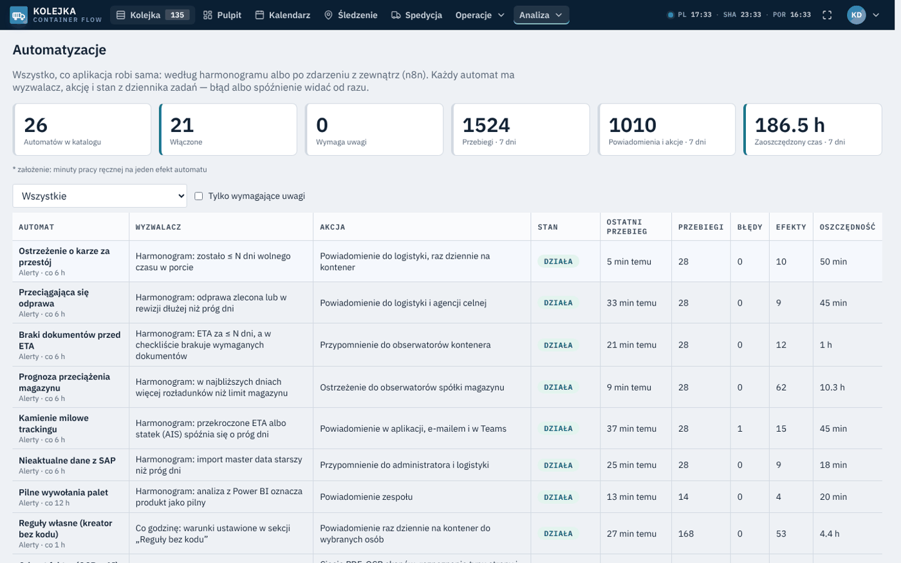
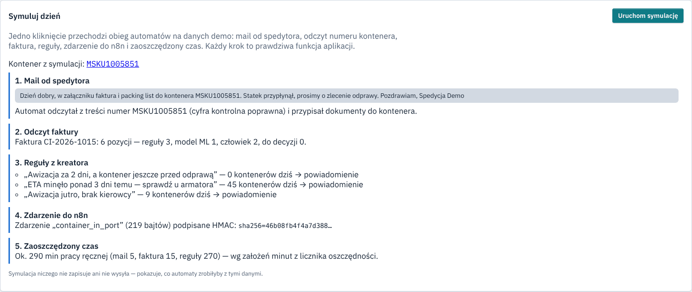
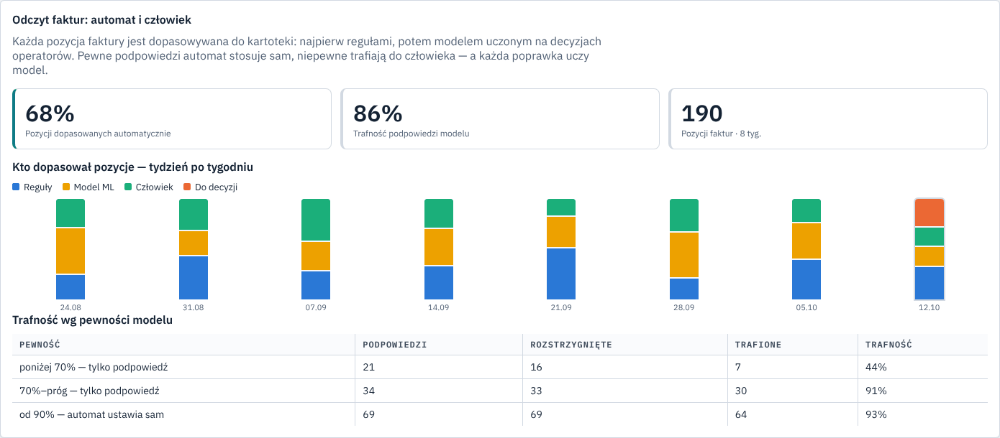
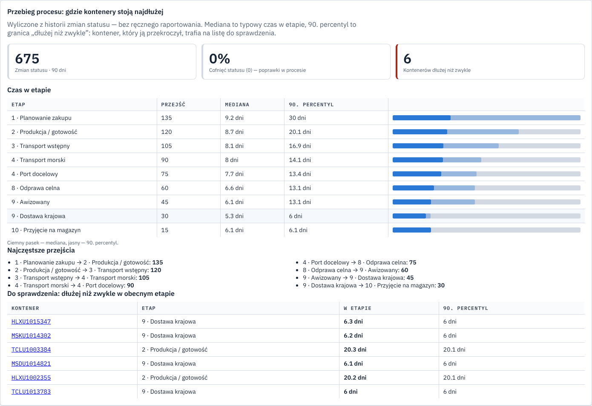

# Container queue — planning import deliveries

[](https://github.com/TomaszWu14/container-queue-public/actions/workflows/ci-backend.yml) [](https://github.com/TomaszWu14/container-queue-public/actions/workflows/ci-frontend.yml) [](https://github.com/TomaszWu14/container-queue-public/actions/workflows/security.yml) [](https://github.com/TomaszWu14/container-queue-public/actions/workflows/ci-migrations.yml) [](https://github.com/TomaszWu14/container-queue-public/actions/workflows/lighthouse.yml)
    [](https://container.queue.twapp.pl/demo)

*[Polska wersja](README.md)*

**One shared view of container deliveries for the logistics teams of several companies, their warehouses,
freight forwarders and the customs agency — replacing an Excel sheet sent around by email.**


📹 [Walkthrough — 2 min, captions, no sound](docs/video/prezentacja.mp4) ·
🎬 [Recruiter path — 20 s](docs/video/sciezka-rekrutera.mp4) ·
🧭 [Guided tour — 1 min, captioned](docs/video/przewodnik-en.mp4) ·
🤖 [Automations — 15 s](docs/video/automatyzacje.mp4)

🌐 **Live demo, no sign-up: [container.queue.twapp.pl/demo](https://container.queue.twapp.pl/demo)** — read-only
account with 150 fictional containers, customs clearance, documents, orders and delivery bookings in progress.
From the main address click **“Enter as demo”** on the login screen (or login `demo`, password `demoportfolio2026`).
With the same password you see the system through the partners' eyes: `demo-spedytor` (forwarder), `demo-agencja`
(customs agency), `demo-magazyn` (warehouse) — each sees only its own containers. The app opens in English for browsers outside Poland and Portugal (language switch in the sidebar or on the login screen).
Try the **Automations** screen and press **“Simulate a day”**.

<table>
  <tr>
    <td></td>
    <td></td>
  </tr>
  <tr>
    <td align="center">Automations: what runs on its own, whether it works, time saved</td>
    <td align="center">“Simulate a day”: the automation flow step by step on demo data</td>
  </tr>
  <tr>
    <td></td>
    <td></td>
  </tr>
  <tr>
    <td align="center">AI invoice reading: who matched the lines, how accurate the model is</td>
    <td align="center">Process mining from the status history</td>
  </tr>
</table>

*Screenshots show the Polish UI; the app switches to English for English-language browsers.*

> **Portfolio project.** Company names are fictional, demo and test data are synthetic.
> The code is shared for review, all rights reserved — [`LICENSE`](LICENSE).

## Problem → solution

The delivery queue of several companies — about **200 containers a month**, 4 companies, 2 warehouses,
3 forwarders — lived in one Excel sheet. Keeping it up to date, reconciling versions and answering emails
took **4 logistics people about 30 hours a week**. The sheet had no container status, no change history
and no validation; partners worked on copies.

The app gives every party the same container state — from the purchase order, through the vessel and
customs clearance, to unloading — with a history of every change and data separated per company and partner.
The delivery slot is agreed with the forwarder through a one-time link, without creating an account for them.

Container lifecycle (10 statuses, Polish names as in the app's data):
`ZAPOWIEDZIANY (announced) → W_PRODUKCJI (in production) → TRANSPORT_WSTEPNY (pre-carriage) → W_TRANSPORCIE (at sea) → W_PORCIE (in port) → ODPRAWA (customs) → AWIZOWANY (slot booked) → W_DOSTAWIE (on the way) → DOSTARCZONY (delivered) → ZREALIZOWANY (closed)`

Customs clearance has its own status:
`BRAK → DOKUMENTY_KOMPLETNE → ZLECONA → DRAFT_WYSLANY → DRAFT_POTWIERDZONY → ODPRAWIONY → ZWOLNIONY → ROZLICZONY`, plus `REWIZJA` (inspection).

## Automation — what the app does on its own

| Area | Examples | Human role |
|---|---|---|
| Documents | email → document inbox (container number read from the text), invoice reading (OCR + rules + ML model with a confidence threshold), customs draft from email | confirms with one click; decides on uncertain suggestions |
| Deadlines | demurrage warning, missing documents before ETA, warehouse overload forecast, vessel delays (AIS), port congestion | decides and acts |
| No-code rules | admin defines “when condition → notify” with a live preview | sets the rules |
| Communication | SMS to the driver the day before, morning digest per company, weekly purchasing digest | — |
| Integrations | HMAC-signed events to n8n / Power Automate / Make, SharePoint sync, Teams cards | builds the next steps |
| Data hygiene | GDPR purge of driver data after 30 days, log retention, backup restore test | reviews reports |

The **Automations** screen shows every automation with its trigger, action, live status (ok / late / failed /
off), runs and effects in the last 7 days, and **hours saved** — with the minutes-per-effect assumption shown
next to the result. It also shows invoice reading quality (share matched automatically, model accuracy by
confidence) and process flow analysis (median and 90th percentile time per stage, containers stuck longer
than usual).

Full matrix (what is automated, what stays with a person, and why):
[`docs/dla-rekrutera/MACIERZ-AUTOMATYZACJI.md`](docs/dla-rekrutera/MACIERZ-AUTOMATYZACJI.md) (Polish).

## Analysis documents (Polish)

| Document | What it covers |
|---|---|
| [01. Problem and scope](docs/01-problem-i-zakres.md) | problem, stakeholders, what is in scope, what the system deliberately does not do and why |
| [02. Process](docs/02-proces.md) | process before and after, actors, status cycle, decision points — Mermaid diagrams |
| [03. User flow](docs/03-user-flow.md) | map of the 18 core screens and transitions, alternative paths, dead ends |
| [04. Data model](docs/04-model-danych.md) | ER diagram, entities, integrity rules, known model inconsistencies |
| [05. Requirements](docs/05-wymagania.md) | 28 requirements with acceptance criteria, where they live in code and which test guards them |
| [06. Decisions](docs/06-decyzje.md) | log of 12 decisions: context, options considered, choice, consequences |
| [07. Limitations](docs/07-ograniczenia.md) | known issues, places without validation, docs vs code gaps, next steps |

Technical details (deployment, integrations, side modules): [`docs/TECHNICZNE.md`](docs/TECHNICZNE.md).

## Documents for reviewers (Polish)

| Document | What it covers |
|---|---|
| [Case study](docs/dla-rekrutera/STUDIUM-PRZYPADKU.md) | problem, approach, solution, how results are measured |
| [Document flow before / after](docs/dla-rekrutera/OBIEG-DOKUMENTU-PRZED-PO.md) | Mermaid diagrams of the email → document → delivery flow |
| [Metrics before / after](docs/dla-rekrutera/MIERNIKI-PRZED-PO.md) | baseline facts, where the app measures each metric, explicit assumptions |
| [Process](docs/02-proces.md) · [BPMN model](docs/bpmn/timporye-proces.bpmn) | whole process before and after, 5 lanes |
| [Requirements](docs/05-wymagania.md) · [Decisions](docs/06-decyzje.md) | 28 requirements with tests, 12 decisions with options considered |
| [Backlog](docs/analiza/HISTORYJKI.md) · [Assumptions](docs/analiza/ZALOZENIA.md) | user stories with acceptance criteria, assumptions awaiting the product owner |
| [Excel, Power BI, Power Automate](docs/MICROSOFT-365.md) · [n8n in 15 min](docs/WLASNA-AUTOMATYZACJA-15-MIN.md) | Power Query on the queue export, DAX measures, two flows; importable n8n workflow |
| [Threat model](docs/bezpieczenstwo/THREAT_MODEL.md) · [Risks](docs/bezpieczenstwo/RYZYKA.md) | STRIDE, risk register, GDPR |
| [API routes and roles](docs/architektura/API-TRASY.md) · [OpenAPI](docs/architektura/openapi.json) | every endpoint with the roles allowed to call it, generated from code and the permission matrix |

## How the work is run

The repository is run like a three-person team — business analyst **[BA]**, developer **[DEV]**, security
**[SEC]** — with a product owner who decides scope, priorities and risks. Every change goes through analysis,
a STRIDE review, implementation with a test per acceptance criterion, security review and BA acceptance
([`CONTRIBUTING.md`](CONTRIBUTING.md)).

## Stack and why

| Part | Why |
|---|---|
| **FastAPI** (Python) | typed API with automatic OpenAPI docs used by the UI, n8n automations and integrations; chosen over Django and Flask ([06](docs/06-decyzje.md), D12) |
| **SQLAlchemy + Alembic** | the same model on SQLite (local, tests) and PostgreSQL (production); versioned migrations run when the image starts |
| **PostgreSQL** | partial unique indexes (container number unique only among active ones), CHECK constraints, trigram search |
| **React + TypeScript (Vite)** | UI in three languages (PL / EN / PT) for users in Poland and Portugal, served by the backend under one address |
| **pytest, vitest, Playwright** | process rules (statuses, permissions, booking links) have tests — requirements in [05](docs/05-wymagania.md) name the test that guards each one |
| **Docker + Coolify** | the same deployment on an own server or a VPS; the image builds the UI and runs migrations itself |

CI: 3000+ tests, backend coverage ≥ 92% enforced, Semgrep, Trivy, Bandit, secret scan, role × route permission
matrix checked by a test, accessibility (axe, WCAG 2.1 AA) and Lighthouse on the login page.

## Run locally

```bash
cp .env.example .env    # fill in POSTGRES_PASSWORD, SECRET_KEY, ADMIN_PASSWORD
docker compose up --build
# UI: http://localhost:8080   API: http://localhost:8000/docs
```

Ports 8000 and 8080 are fixed in `docker-compose.yml` — free them or change the mapping if they are taken.

**Without Docker** (SQLite; Node 26 and Python 3.14 — the same versions as the production image and CI; the
dependency lock works from Python 3.12):

```bash
cd frontend && npm ci && npm run build      # UI goes to frontend/dist
cd ../backend
python -m venv .venv && source .venv/bin/activate   # Windows: .venv\Scripts\activate
pip install -r requirements.txt
uvicorn app.main:app                          # http://localhost:8000  (admin / admin123)
```

**Demo data** — without it the queue is empty. The script **wipes all data** in the target database and loads
150 fictional containers and a read-only `demo` account:

```bash
cd backend
export DEMO_READONLY_LOGINS=demo DEMO_PASSWORD='<at least 12 characters>'
python -m scripts.seed_demo --wyczysc-wszystko
uvicorn app.main:app                          # log in as demo
```

Backend tests: `pip install -r requirements-dev.txt && python -m pytest tests/`. Frontend: `cd frontend && npm test`.

## Scope and limitations

In scope is the core process: the queue, the container lifecycle, customs clearance, documents, delivery
planning and booking, unloading, data separation and change history. What the system deliberately does not
do — it does not write to SAP, does not yet track containers with the shipping line, does not block a status
when documents are missing — is described in [01](docs/01-problem-i-zakres.md); known issues and limitations
in [07](docs/07-ograniczenia.md). Side modules (transport quotes, AIS vessel tracking, invoices, complaints,
analytics) are described in [`docs/TECHNICZNE.md`](docs/TECHNICZNE.md).

## Contact

Built solo, July–October 2026: interviews and requirements, process and data model, decisions,
implementation, tests and deployment. Questions: tomasz.wierzbowski [at] op.pl
