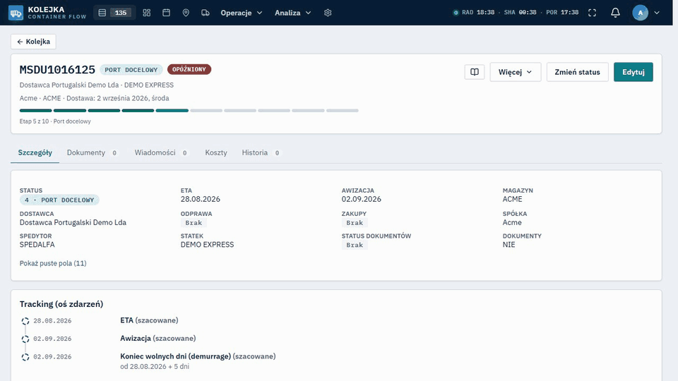

# Kolejka kontenerów — planowanie dostaw importowych

[](https://github.com/TomaszWu14/container-queue-public/actions/workflows/ci-backend.yml) [](https://github.com/TomaszWu14/container-queue-public/actions/workflows/ci-frontend.yml)

**Jeden wspólny obraz dostaw kontenerowych dla logistyki kilku spółek, magazynów, spedytorów i agencji
celnej — w miejsce arkusza Excel rozsyłanego mailem.**



📹 [Prezentacja działania — 2 min, z napisami, bez dźwięku](docs/video/prezentacja.mp4)

🌐 **Demo online: [container.queue.twapp.pl](https://container.queue.twapp.pl)** — login `demo`,
hasło `demoportfolio2026` (tylko podgląd, 150 fikcyjnych kontenerów, dane wgrywane od nowa przy każdym
wdrożeniu). Lokalnie uruchomisz to samo trzema komendami — sekcja [Jak uruchomić](#jak-uruchomić).

> **Projekt portfolio.** Nazwy firm są zamienione na fikcyjne, dane demo i testowe są syntetyczne.
> Kod udostępniony do wglądu, wszelkie prawa zastrzeżone — [`LICENSE`](LICENSE).

## Problem → rozwiązanie

Kolejka dostaw kilku spółek — ok. 200 kontenerów miesięcznie — żyła w jednym arkuszu Excel, który
4 osobom w logistyce zabierał łącznie ok. 30 godzin tygodniowo. Arkusz nie miał statusu kontenera ani
historii zmian, a magazyny, spedytorzy i agencja celna pracowali na kopiach pliku i na mailach.
Aplikacja daje każdej stronie ten sam stan kontenera — od zamówienia, przez statek i odprawę, po
rozładunek — z historią każdej zmiany i z podziałem danych między spółki i partnerów.
Termin dostawy uzgadnia się ze spedytorem przez jednorazowy link, bez zakładania mu konta.

Cykl życia kontenera (10 statusów):
`ZAPOWIEDZIANY → W_PRODUKCJI → TRANSPORT_WSTEPNY → W_TRANSPORCIE → W_PORCIE → ODPRAWA → AWIZOWANY → W_DOSTAWIE → DOSTARCZONY → ZREALIZOWANY`

Odprawa celna — osobny status:
`BRAK → DOKUMENTY_KOMPLETNE → ZLECONA → DRAFT_WYSLANY → DRAFT_POTWIERDZONY → ODPRAWIONY → ZWOLNIONY → ROZLICZONY`, oraz `REWIZJA`.

## Dokumentacja analityczna

| Dokument | Co zawiera |
|---|---|
| [01. Problem i zakres](docs/01-problem-i-zakres.md) | problem, interesariusze, co jest w zakresie, czego system świadomie nie robi i dlaczego |
| [02. Proces](docs/02-proces.md) | proces przed i po wdrożeniu, aktorzy, cykl statusów, punkty decyzyjne — diagramy Mermaid |
| [03. User flow](docs/03-user-flow.md) | mapa 18 ekranów rdzenia i przejść między nimi, ścieżki alternatywne, ślepe zaułki |
| [04. Model danych](docs/04-model-danych.md) | diagram ER, opis encji, reguły integralności, znane niespójności modelu |
| [05. Wymagania](docs/05-wymagania.md) | 28 wymagań z kryteriami akceptacji, miejscem w kodzie i testem, który ich pilnuje |
| [06. Decyzje](docs/06-decyzje.md) | dziennik 12 decyzji: kontekst, rozważane opcje, wybór, skutki |
| [07. Ograniczenia](docs/07-ograniczenia.md) | znane problemy, miejsca bez walidacji, rozjazdy dokumentacji z kodem, co dalej |

Szczegóły techniczne (wdrożenie, integracje, moduły poboczne): [`docs/TECHNICZNE.md`](docs/TECHNICZNE.md).

## Jak uruchomić

Sprawdzone od zera na świeżym klonie (Windows, 2026-10-11).

**Docker** (PostgreSQL + API + panel):

```bash
cp .env.example .env    # uzupełnij POSTGRES_PASSWORD, SECRET_KEY, ADMIN_PASSWORD
docker compose up --build
# panel: http://localhost:8080   API: http://localhost:8000/docs
```

Porty 8000 i 8080 są stałe w `docker-compose.yml` — jeśli są zajęte, zwolnij je albo zmień mapowanie.

**Bez Dockera** (SQLite; Node 22.12+, Python 3.12–3.14):

```bash
cd frontend && npm ci && npm run build      # panel trafia do frontend/dist
cd ../backend
python -m venv .venv && source .venv/bin/activate   # Windows: .venv\Scripts\activate
pip install -r requirements.txt
uvicorn app.main:app                          # http://localhost:8000  (admin / admin123)
```

**Dane pokazowe** — bez nich kolejka jest pusta. Skrypt **kasuje wszystkie dane** w bazie, której
dotyczy, i wgrywa 150 fikcyjnych kontenerów oraz konto `demo` tylko do odczytu:

```bash
cd backend
export DEMO_READONLY_LOGINS=demo DEMO_PASSWORD='<min. 12 znaków>'
python -m scripts.seed_demo --wyczysc-wszystko
uvicorn app.main:app                          # zaloguj się jako demo
```

Testy backendu: `pip install -r requirements-dev.txt && python -m pytest tests/`
(ok. 2100 testów, ok. 20 min). Frontend: `cd frontend && npm test`.

## Stack i dlaczego taki

| Element | Dlaczego |
|---|---|
| **FastAPI** (Python) | typowane API z automatyczną dokumentacją OpenAPI, z której korzystają panel, automatyzacje n8n i integracje; wybrane spośród Django, FastAPI i Flask ([06](docs/06-decyzje.md), D12) |
| **SQLAlchemy + Alembic** | ten sam model na SQLite (lokalnie, w testach) i PostgreSQL (produkcja); migracje wersjonowane i uruchamiane przy starcie obrazu |
| **PostgreSQL** | częściowe indeksy unikalne (numer kontenera unikalny tylko wśród aktywnych), CHECK-i, wyszukiwanie trigramowe |
| **React + TypeScript (Vite)** | panel w trzech językach (PL / EN / PT) dla użytkowników w Polsce i Portugalii, serwowany przez backend pod jednym adresem |
| **pytest, vitest, Playwright** | reguły procesu (statusy, uprawnienia, linki awizacji) mają testy — wymagania w [05](docs/05-wymagania.md) wskazują, który test czego pilnuje |
| **Docker + Coolify** | to samo wdrożenie na własnym serwerze albo VPS; obraz sam buduje panel i uruchamia migracje |

## Zakres i ograniczenia

W zakresie jest rdzeń procesu: kolejka, cykl kontenera, odprawa, dokumenty, plan i awizacja dostawy,
rozładunek, separacja danych i historia zmian. Czego system świadomie nie robi — nie zapisuje do SAP,
na razie nie śledzi kontenerów u armatora, nie blokuje statusu przy brakach dokumentów — opisuje
[01](docs/01-problem-i-zakres.md); znane problemy i ograniczenia — [07](docs/07-ograniczenia.md).

Aplikacja ma też moduły poboczne (wyceny transportu, śledzenie statków AIS, faktury, reklamacje,
analityka), opisane technicznie w [`docs/TECHNICZNE.md`](docs/TECHNICZNE.md).

## Kontekst projektu

System powstał dla działu logistyki grupy kilku spółek importujących towar w kontenerach
(ok. 200 kontenerów miesięcznie, 4 spółki, 2 magazyny, 3 spedytorów). Arkusz kolejki kosztował
4 osoby łącznie ok. 30 godzin tygodniowo.

Prowadziłem projekt sam, od lipca do października 2026: wywiad projektowy i wymagania
([SPECYFIKACJA.md](docs/SPECYFIKACJA.md)), model procesu i danych, decyzje, implementację,
testy i wdrożenie. Aplikacja jest obecnie w fazie testów z użytkownikami.
