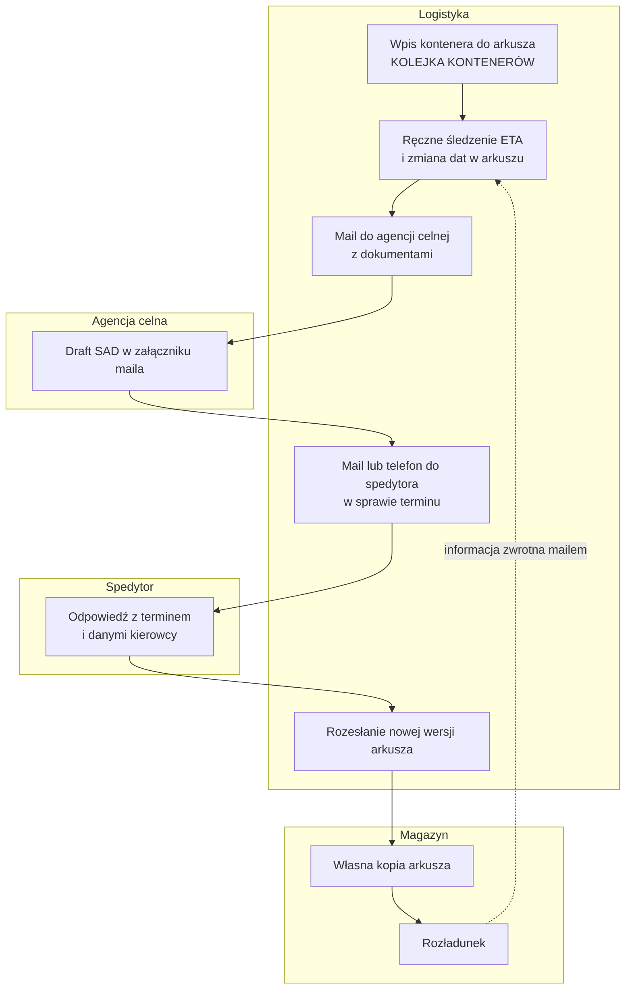
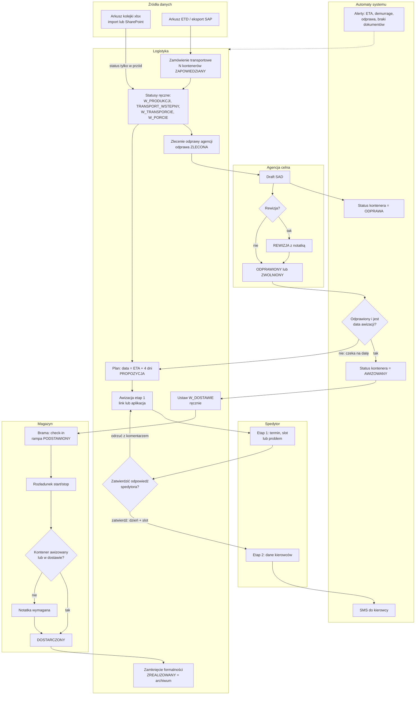
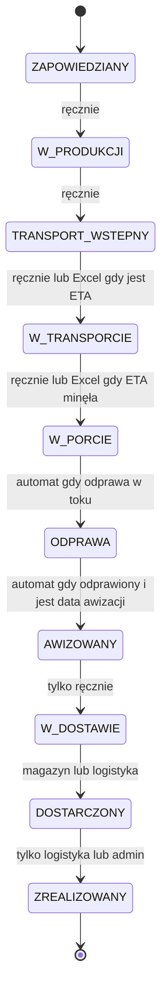

# 02. Proces biznesowy

Proces odtworzony z kodu (stan: commit `9dd73a1`). Każda reguła ma wskazane miejsce w kodzie.
Ścieżki `backend/app/...` skrócone do nazwy pliku tam, gdzie to jednoznaczne.

## Aktorzy

| Aktor | Rola | Kluczowe akcje w procesie |
|---|---|---|
| Logistyka | `logistics` | zakłada kontenery i zamówienia, zmienia statusy, zleca odprawę, planuje datę dostawy, wysyła i zatwierdza awizację, ustawia ZREALIZOWANY |
| Agencja celna | `customs` | prowadzi odprawę i zmienia jej status; REWIZJA tylko z notatką |
| Spedytor | `forwarder` lub link z e-maila | potwierdza termin dostawy, podaje dane kierowców, realizuje zlecenie transportowe |
| Magazyn | `warehouse` | przyjmuje auto na bramie, rozładowuje, ustawia **wyłącznie** DOSTARCZONY |
| Zakupy | `purchasing` | wgrywa dokumenty, prowadzi status zakupowy |
| System | automaty | wylicza status kontenera z odprawy, wysyła alerty, wygasza linki, anonimizuje dane kierowców |

Spedytor nie musi mieć konta: awizacja działa też przez jednorazowe linki w e-mailu
(`avizo_workflow.py:84-175`). Szczegóły w [06-decyzje.md](06-decyzje.md), D3.

## Proces PRZED aplikacją

Odtworzony z importera arkusza i dokumentów projektu, nie z rozmowy z użytkownikami.
Dowody: kolumny arkusza w `importers/queue.py:41-61`, plik na SharePoincie (`config.py:223`),
drafty SAD z poczty (`tools/outlook-sad/Zbierz-SAD.ps1`), `docs/superpowers/specs/2026-08-31-excel-sharepoint-sync-design.md`.

Problemy tego układu opisuje [01-problem-i-zakres.md](01-problem-i-zakres.md).
Skala: ok. 200 kontenerów miesięcznie, arkusz prowadziły 4 osoby w logistyce, łącznie ok. 30 godzin
tygodniowo na utrzymanie arkusza i uzgadnianie wersji.

## Proces PO wdrożeniu

Kolejność AWIZOWANY → W_DOSTAWIE → DOSTARCZONY nie jest wymuszona: logistyka może przeskoczyć
etapy w przód, a magazyn może potwierdzić DOSTARCZONY z każdego statusu (wtedy z notatką).

## Cykl życia kontenera

Kolejność wartości w kodzie = kolejność procesu (`models/enums.py:86-97`).

Reguły przejść (`routers/containers_common.py:333-343`):

- do przodu — dowolnie, także o kilka etapów;
- wstecz o 1 krok — tylko z notatką;
- wstecz o więcej niż 1 krok — tylko administrator, też z notatką;
- magazyn może ustawić wyłącznie DOSTARCZONY (`routers/containers_write.py:216-218`).

Dwa pojęcia „zakończenia” (`models/container.py:251-273`): **DOSTARCZONY** = fizycznie
rozładowany (koniec demurrage, limitów, SMS), ale nadal w kolejce do rozliczenia;
**ZREALIZOWANY** = archiwum.

## Tory równoległe

Kontener ma obok statusu głównego kilka niezależnych statusów.

| Tor | Wartości | Reguły | Kod |
|---|---|---|---|
| Odprawa celna | BRAK → DOKUMENTY_KOMPLETNE → ZLECONA → DRAFT_WYSLANY → DRAFT_POTWIERDZONY → ODPRAWIONY → ZWOLNIONY → ROZLICZONY, oraz REWIZJA | zmienia agencja (logistyka awaryjnie, spedytor nigdy); REWIZJA i cofnięcie z ODPRAWIONY tylko z notatką; kolejność **nie** jest wymuszona | `containers_common.py:347-369` |
| Dokumenty | BRAK → ZALACZONE → WYSLANE | pierwszy dokument z typem → ZALACZONE; wysyłka do agencji → WYSLANE | `forwarding_files.py:210-213`, `customs.py:381-430` |
| Plan dostawy | PROPOZYCJA → WYSLANE → POTWIERDZONE | wysłanie planu zamraża datę; zmiana daty po uzgodnieniu cofa do PROPOZYCJA | `planning.py:51-135` |
| Awizacja | DRAFT → SENT_STAGE1 → CONFIRMED_BY_FORWARDER → APPROVED_BY_US → SENT_STAGE2 → DRIVERS_SUBMITTED → CLOSED, oraz REJECTED, EXPIRED, CANCELLED | jedna maszyna stanów, przejście warunkowe chroni przed podwójnym kliknięciem | `avizo_workflow.py:40-81` |
| Rampa | PODSTAWIONY, ROZLADOWANY, PRZYJETY | check-in na bramie ustawia PODSTAWIONY; nie zmienia statusu kontenera | `warehouse_ops.py:104-189` |

## Punkty decyzyjne

| Decyzja | Warunek | Skutek | Kod |
|---|---|---|---|
| Status kontenera z odprawy | odprawa w toku / odprawiony + data awizacji | ODPRAWA / AWIZOWANY (tylko w przód) | `containers_common.py:443-458` |
| Rewizja celna | status REWIZJA | notatka obowiązkowa | `containers_common.py:360-362` |
| Wysłać dokumenty agencji mimo braków? | brak typów z checklisty | blokada 409, chyba że użytkownik potwierdzi „mimo braków” (zapis w audycie) | `customs.py:409-416` |
| Zatwierdzić awizację etap 1? | wszystkie kontenery „problem” → 409; slot zajęty → 409 | zatwierdzenie wysyła etap 2, odrzucenie wysyła nowy link etapu 1 | `avizo_workflow.py:287-340` |
| Przekroczony limit dzienny magazynu? | liczba potwierdzonych dostaw > limit | ostrzeżenie i wpis w audycie, bez blokady | `planning.py:92-115` |
| Data zmieniona po uzgodnieniu? | plan ≠ PROPOZYCJA | plan wraca do PROPOZYCJA | `containers_write.py:144-148` |
| Rozładunek bez awizacji? | magazyn, status poza AWIZOWANY / W_DOSTAWIE / DOSTARCZONY | notatka obowiązkowa | `containers_write.py:223-226` |
| Cofnięcie statusu | wstecz 1 krok / więcej | notatka / tylko admin | `containers_common.py:333-343` |
| Kontener tranzytowy? | numer zamówienia zaczyna się od „47” | flaga tranzytu, poza limitem dziennym, automatyczny szkic wyceny | `quotes_core.py:50-74` |
| Excel kontra aplikacja | to samo pole zmienione w obu miejscach | wygrywa nowsza zmiana; status i odprawa tylko w przód | `importers/queue.py:374-421` |
