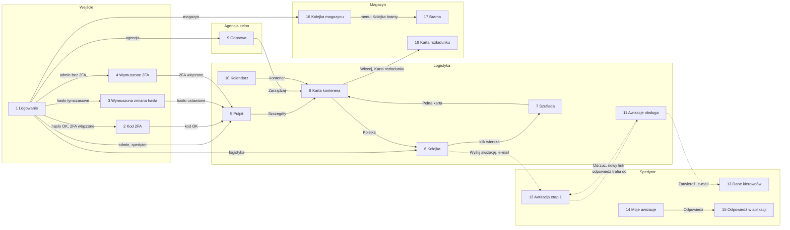
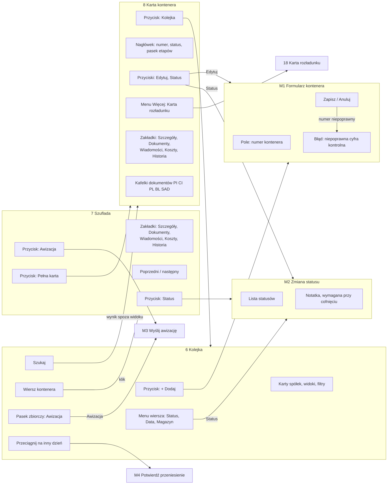
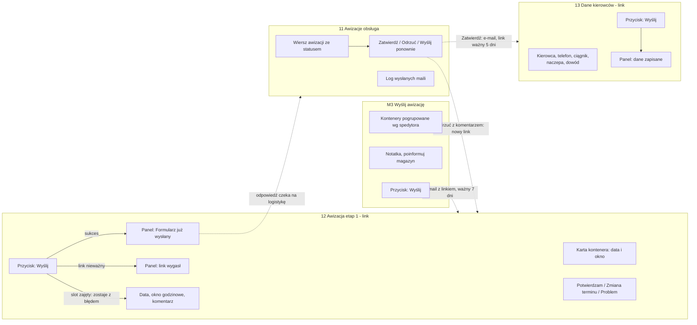

# 03. User flow — mapa ekranów i przejść

Mapa obejmuje ekrany rdzenia procesu (patrz [01](01-problem-i-zakres.md)): wejście do systemu,
kolejkę i kartę kontenera, odprawę, awizację ze spedytorem i przyjęcie w magazynie.
Aplikacja ma ok. 57 ekranów i 23 okna modalne; ekrany modułów pobocznych (reklamacje, wyceny,
zamówienia, administracja) są tu pominięte.

Ścieżki do plików: `frontend/src/` skrócone do `FE/`, `backend/app/` do `BE/`.

## Lista ekranów

| Nr | Ekran | Adres | Kto ma dostęp | Typ | Plik |
|---|---|---|---|---|---|
| 1 | Logowanie | `/` | gość | strona | `FE/pages/LoginPage.tsx:75` |
| 2 | Kod 2FA | jak 1 | gość z włączonym 2FA | krok strony | `FE/pages/LoginPage.tsx:157` |
| 3 | Wymuszona zmiana hasła | dowolny | konto z hasłem tymczasowym | bramka | `FE/pages/AuthPages.tsx:47` |
| 4 | Wymuszone włączenie 2FA | dowolny | admin bez 2FA, gdy polityka wymaga | bramka | `FE/pages/Enroll2FAPage.tsx:8` |
| 5 | Pulpit „Co dziś” | `/pulpit` | admin, logistyka, spedytor | strona | `FE/pages/DashboardPage.tsx:78` |
| 6 | Kolejka kontenerów | `/kolejka` | admin, logistyka, spedytor, zakupy, sprzedaż | strona | `FE/pages/QueuePage.tsx:53` |
| 7 | Szuflada kontenera | `/kolejka?kontener=` | jak 6 | panel boczny | `FE/pages/queue/QueueDrawer.tsx:19` |
| 8 | Karta kontenera | `/kontenery/:id` | każdy, w granicach swojego zakresu danych | strona | `FE/pages/ContainerPage.tsx:31` |
| 9 | Agencja celna | `/kolejka` (agencja), `/odprawa` | agencja, admin, logistyka | strona | `FE/pages/CustomsPage.tsx:106` |
| 10 | Kalendarz awizacji | `/kalendarz` | wszyscy poza agencją i zakupami | strona | `FE/pages/CalendarPage.tsx:21` |
| 11 | Awizacje — obsługa | `/awizacje/propozycje` | admin, logistyka | strona | `FE/pages/AvizoProposalsPage.tsx:251` |
| 12 | Awizacja etap 1 (link) | `/avizo/:token` | posiadacz linku, bez konta | strona publiczna | `FE/pages/AvizoFormPage.tsx:124` |
| 13 | Dane kierowców (link) | `/avizo/driver/:token` | posiadacz linku, bez konta | strona publiczna | `FE/pages/AvizoDriverFormPage.tsx:43` |
| 14 | Moje awizacje | `/awizacje/moje` | spedytor z kontem | strona | `FE/pages/MyAvizosPage.tsx:31` |
| 15 | Odpowiedź na awizację | `/awizacje/moje/:id` | spedytor z kontem | strona | `FE/pages/MyAvizosPage.tsx:22` |
| 16 | Kolejka magazynu | `/kolejka` (magazyn) | magazyn | strona | `FE/pages/WarehouseQueuePage.tsx:59` |
| 17 | Kolejka bramy | `/brama` | admin, logistyka, magazyn | strona | `FE/pages/GatePage.tsx:37` |
| 18 | Karta rozładunku | `/kontenery/:id/karta` | akcje: admin, logistyka, magazyn | strona | `FE/pages/KartaRozladunkuPage.tsx:36` |
| M1 | Formularz kontenera | — | admin, logistyka | modal | `FE/components.tsx:130` |
| M2 | Zmiana statusu | — | wg roli (magazyn: tylko DOSTARCZONY) | modal | `FE/components.tsx:387` |
| M3 | Wyślij awizację | — | admin, logistyka | modal | `FE/pages/AvizoSendModal.tsx:15` |
| M4 | Potwierdź przeniesienie terminu | — | admin, logistyka | modal | `FE/pages/queue/MoveConfirm.tsx:12` |

Strona startowa po zalogowaniu zależy od roli (`FE/routing.tsx:101-104`): logistyka, zakupy
i sprzedaż → 6; admin i spedytor → 5; magazyn → 16; agencja celna → 9.

## Diagram: przegląd

Linia przerywana = przejście przez e-mail, czyli do innej osoby albo innej sesji.

## Diagram: kolejka i karta kontenera

## Diagram: awizacja ze spedytorem

## Tabela ekranów i przejść

| Nr | Ekran | Elementy | Akcja użytkownika | Prowadzi do |
|---|---|---|---|---|
| 1 | Logowanie | login, hasło, Zaloguj, „Nie pamiętam hasła”, podpowiedź dla spedytora „skorzystaj z linku z e-maila”, język PL/EN/PT | Zaloguj | 2 / 3 / 4 / strona startowa wg roli |
| 2 | Kod 2FA | pole kodu, Weryfikuj, Wróć | Weryfikuj | strona startowa |
| 3 | Wymuszona zmiana hasła | nowe hasło ×2, Ustaw hasło | Ustaw hasło | strona startowa |
| 4 | Wymuszone 2FA | QR, kod, kody zapasowe, Dalej, Wyloguj | Dalej / Wyloguj | strona startowa / 1 |
| 5 | Pulpit | KPI (decyzje, demurrage, dziś, jutro), tabela akcji, aktualności, eksport CSV | Szczegóły w wierszu | 8 |
| 6 | Kolejka | karty spółek, widoki, filtry, szukaj, + Dodaj, tabela pogrupowana datami, pasek zbiorczy | klik wiersza | 7 |
| 6 | Kolejka | j.w. | + Dodaj | M1 |
| 6 | Kolejka | j.w. | menu wiersza → Status | M2 |
| 6 | Kolejka | j.w. | zaznacz → Awizacja | M3 |
| 6 | Kolejka | j.w. | przeciągnij na inny dzień | M4 → toast z „Cofnij” |
| 7 | Szuflada | zakładki, poprzedni/następny, Status, Awizacja, Pełna karta | Pełna karta | 8 |
| 8 | Karta kontenera | Kolejka, poprzedni/następny, Edytuj, Status, Więcej, zakładki, kafelki dokumentów, panel kierowcy | Kolejka | 6 |
| 8 | Karta kontenera | j.w. | Edytuj / Status | M1 / M2 |
| 8 | Karta kontenera | j.w. | Więcej → Karta rozładunku | 18 |
| 9 | Agencja celna | Przypisz, filtry, zakładki statusów odprawy, lista statusów w wierszu, Zarządzaj | zmiana statusu odprawy w wierszu | zapis od razu + toast |
| 9 | Agencja celna | j.w. | Zarządzaj | 8 |
| 10 | Kalendarz | filtr magazynu, rok/miesiąc, KPI, siatka dni, panel dnia | kontener w panelu dnia | 8 |
| 11 | Awizacje obsługa | filtry, tabela awizacji, Zatwierdź, Odrzuć, Wyślij ponownie, log maili | Zatwierdź | e-mail → 13 |
| 11 | Awizacje obsługa | j.w. | Odrzuć z komentarzem | e-mail → 12 |
| 12 | Awizacja etap 1 | karta per kontener: Potwierdzam / Zmiana terminu / Problem, data, okno, komentarz, Wyślij | Wyślij | panel końcowy; odpowiedź trafia do 11 |
| 13 | Dane kierowców | 5 pól na kontener, klauzula RODO, Wyślij | Wyślij | panel końcowy |
| 14 | Moje awizacje | tabela awizacji, Odpowiedz, Zaproponuj termin | Odpowiedz | 15 |
| 15 | Odpowiedź w aplikacji | formularz etapu 1 lub 2 | Wyślij | panel końcowy |
| 16 | Kolejka magazynu | tabela dostaw, rozwinięcie: materiały, palety, reklamacje | Pokaż | rozwinięcie wiersza |
| 17 | Brama | karta per ciężarówka, etap rampy, Opóźnienie, Przyjechał | Przyjechał | zapis + powiadomienie logistyki |
| 18 | Karta rozładunku | QR, dane, checklista, Start/Stop, zdjęcia, Zgłoś reklamację | Start / Stop | toast |
| M1 | Formularz kontenera | numer (wymagany), pola dostawy, Zapisz, Anuluj | Zapisz | wiersz w 6 |
| M2 | Zmiana statusu | lista statusów, notatka | Zapisz | status zmieniony; cofnięcie → potwierdzenie |
| M3 | Wyślij awizację | kontenery wg spedytora, notatka, Wyślij | Wyślij | wynik w modalu; e-mail → 12 |

## Ścieżki alternatywne

**Gość kontra zalogowany.** Spedytor bez konta pracuje tylko przez linki z e-maili (12, potem 13).
Spedytor z kontem odpowiada przez 14 → 15; odpowiedź w aplikacji unieważnia link z e-maila
tego etapu (`BE/routers/avizo_forwarder.py:98`). Zalogowany, który otworzy link 12 lub 13,
widzi formularz z menu aplikacji.

**Modal kontra pełna strona.** Kontener można obejrzeć w szufladzie 7 (szybki podgląd, przewijanie
między wierszami) albo na pełnej karcie 8. Formularz kontenera i zmiana statusu są zawsze
modalami (M1, M2) — ten sam komponent w kolejce i na karcie.

**Błędy walidacji.**

| Miejsce | Jak widać błąd |
|---|---|
| Logowanie, 2FA, zmiana hasła | czerwony tekst nad przyciskiem |
| Formularze 12 i 13 | komunikat pod polem po pierwszej próbie, błąd serwera nad przyciskiem |
| Modale M1–M3 | komunikat w oknie modala |
| Błędy serwera | spolszczone komunikaty (`FE/api.ts:51-77`): dane formularza, limit żądań, brak sieci |

**Przerwanie procesu.**

- Zamknięcie modala: o porzucenie zmian pytają tylko M1 i M2 (`FE/formGuard.ts:9-22`).
  M3 i pozostałe zamykają się bez pytania.
- Wygaśnięcie sesji: aplikacja próbuje odświeżyć sesję raz, potem pokazuje logowanie pod tym
  samym adresem; dane w otwartych formularzach przepadają (`FE/api.ts:79-120`).
- Wygasły link: 12 i 13 pokazują „Formularz nie istnieje lub wygasł”; logistyka może wysłać
  link ponownie z ekranu 11.

## Ślepe zaułki i akcje bez informacji zwrotnej

| Ekran / akcja | Obserwacja | Kod |
|---|---|---|
| 3 Wymuszona zmiana hasła | brak przycisku „Wyloguj” (ekran 4 go ma) | `FE/pages/AuthPages.tsx:70-87` |
| 12, 13 po wysłaniu | panel końcowy bez żadnej akcji; sukces i „już wysłano” mają ten sam nagłówek | `FE/pages/AvizoFormPage.tsx:111-117` |
| 15 po wysłaniu | brak powrotu do listy 14 | `FE/pages/MyAvizosPage.tsx:22-29` |
| 16 Kolejka magazynu | brak linku do karty kontenera | `FE/pages/WarehouseQueuePage.tsx:19-57` |
| 17 Brama | numer kontenera nie jest linkiem | `FE/pages/GatePage.tsx:91-144` |
| 18 Karta rozładunku | brak powrotu do karty 8 | `FE/pages/KartaRozladunkuPage.tsx:115-186` |
| M1 dodanie / edycja kontenera | brak komunikatu po zapisie | `FE/pages/QueuePage.tsx:436` |
| M2 zmiana statusu z kolejki | brak komunikatu (z karty 8 jest) | `FE/pages/QueuePage.tsx:452` |
| 15 odpowiedź z błędem 409 | aplikacja pokazuje sukces, choć nic nie zapisano | `FE/pages/AvizoFormPage.tsx:185`, `BE/routers/avizo_forwarder.py:54-58` |
