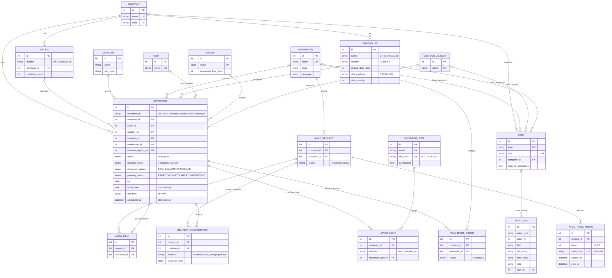

# 04. Model danych

Baza ma 106 tabel (`backend/app/models/`). Ten dokument opisuje 18 encji rdzenia procesu.
Pełna lista tabel jest w kodzie modeli; migracje schematu w `backend/migrations/` (Alembic).

## Diagram ER (rdzeń)

## Encje

| Encja | Tabela | Co reprezentuje | Kod |
|---|---|---|---|
| Container | `containers` | jedna dostawa kontenerowa; centrum modelu (ok. 80 kolumn) | `models/container.py:57` |
| Company | `companies` | spółka grupy; granica separacji danych | `models/dictionaries.py:29` |
| User | `users` | konto z rolą i powiązaniem (spółka / spedytor / agencja / magazyn) | `models/dictionaries.py:39` |
| Order | `orders` | zamówienie (PO) lub zlecenie spedycyjne; 1 zamówienie → N kontenerów | `models/orders.py:113` |
| Supplier, Forwarder, Port, Carrier, CustomsAgency | słowniki | partnerzy i miejsca; armator niesie domyślne dni wolne demurrage | `models/dictionaries.py` |
| Warehouse | `warehouses` | magazyn spółki: kraj (kalendarz świąt), limit dzienny, okna i pojemność slotów | `models/dictionaries.py:215` |
| AvizoRequest, AvizoItem | `avizo_requests`, `avizo_items` | awizacja do jednego spedytora dla jednej spółki i jej kontenery | `models/avizo.py:28,59` |
| AvizoFormToken | `avizo_form_tokens` | jednorazowy link etapu 1 lub 2; w bazie tylko skrót SHA-256 | `models/avizo.py:68` |
| DeliveryConfirmation | `avizo_delivery_confirmations` | odpowiedź spedytora per kontener; działa dopiero po zatwierdzeniu | `models/avizo.py:84` |
| Attachment, DocumentType | `attachments`, `document_types` | dokument przy kontenerze i jego typ (kafelek PI / CI / PL / BL / SAD) | `models/transport.py:157`, `models/dictionaries.py:195` |
| TransportOrder | `transport_orders` | zlecenie dowozu dla spedytora z własnym obiegiem statusów | `models/transport.py:26` |
| AuditLog | `audit_log` | historia zmian każdego pola każdej encji: kto, kiedy, było, jest, powód | `models/system.py:22` |

## Reguły integralności

### Pilnowane przez bazę

| Reguła | Mechanizm | Kod |
|---|---|---|
| Numer kontenera unikalny w spółce, ale tylko wśród niezrealizowanych (powtórny przyjazd tego samego kontenera = nowy rekord) | częściowy indeks unikalny `ux_containers_active_no` | `models/container.py:79-81` |
| Etap rampy, powód zlecenia specjalnego, tryb dowozu z zamkniętej listy | CHECK | `models/container.py:64-91` |
| Koniec rozładunku nie wcześniej niż start; liczba palet ≥ 0 | CHECK | `models/container.py:64-91` |
| Ten sam plik nie trafi dwa razy do jednego kontenera | UNIQUE (container_id, sha256) | `models/transport.py:157` |
| Skrót linku awizacji jest unikalny | UNIQUE token_hash | `models/avizo.py:76` |
| Numer zamówienia unikalny w spółce | UNIQUE (company_id, number) | `models/orders.py:113` |

### Pilnowane przez aplikację

| Reguła | Kod |
|---|---|
| Numer kontenera zgodny z ISO 6346 (format i cyfra kontrolna) | `iso6346.py`, `schemas/containers.py:67-74` |
| Dostawca, magazyn i zamówienie muszą należeć do spółki kontenera | `routers/containers_common.py:265-282` |
| Przejścia statusów kontenera, odprawy, awizacji, zlecenia transportowego | [02-proces.md](02-proces.md) |
| Każdy użytkownik widzi tylko kontenery ze swojego zakresu; rekord spoza zakresu = 404 | `deps.py:60-142`, `deps.py:363-468` |
| Konto ma powiązanie zgodne z rolą (spedytor → firma spedycyjna, magazyn → magazyn) | `routers/admin.py:50-69` |
| Usunięcie kontenera kasuje jego rekordy zależne (baza nie ma kaskad) | `routers/containers_purge.py:52-58` |

## Znane niespójności modelu

Obserwacje z analizy, nie zadania. Pełna lista (39 pozycji) jest w raporcie z rekonstrukcji.

| # | Obserwacja | Skutek | Kod |
|---|---|---|---|
| 1 | Dwa statusy odprawy: stały `customs_status` i słownikowy `customs_case_status_id`, niezwiązane ze sobą | raport może pokazać sprzeczne wartości | `models/container.py:141,157` |
| 2 | Agencja celna jako tekst z importu i jako klucz obcy | nie wiadomo, które pole jest nadrzędne | `models/container.py:148,150` |
| 3 | Stan dokumentów w trzech polach: `documents_ok`, `document_status`, `document_flow` | dwa z nich to pozostałość po Excelu | `models/container.py:160,196,207` |
| 4 | Powiązanie zamówienie ↔ kontener na cztery sposoby (FK, tekst, dwie tabele zamówień) | dopasowanie po tekście może się rozjechać | `models/container.py:95,204` |
| 5 | Dwa modele zlecenia transportu (`TransportOrder` i `TransportJob` + `Quote`) | wybór oferty nie ustawia spedytora na kontenerze | `models/transport.py:26,49` |
| 6 | Brak UNIQUE (request_id, container_id) w `AvizoItem` i `DeliveryConfirmation` | ten sam kontener może trafić do awizacji dwa razy | `models/avizo.py:59,84` |
| 7 | Kilkanaście statusów pomocniczych jako zwykły tekst bez CHECK | baza przyjmie dowolną wartość | np. `models/avizo.py:90` |
| 8 | `transport_id` nullable, choć logika nadaje go każdemu kontenerowi | ograniczenie słabsze niż reguła | `models/container.py:202` |
| 9 | Zgodność spółki między kontenerem a rekordami powiązanymi pilnowana tylko w kodzie | izolacja zależy od `deps.py` | `models/complaints.py:59`, `models/transport.py:31` |
