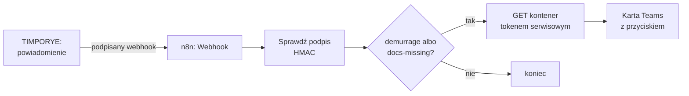

# Własna automatyzacja w n8n w 15 minut

Cel: gdy aplikacja ostrzeże o **karze za przestój** albo **brakach dokumentów**, w kanale Teams pojawia się
karta z danymi kontenera i przyciskiem „Otwórz w aplikacji”. Bez kodu w aplikacji — wszystko w n8n.
Gotowy workflow do zaimportowania: [`deploy/n8n/zdarzenie-do-teams.json`](../deploy/n8n/zdarzenie-do-teams.json).

## Czego potrzebujesz (2 min)

- działające n8n obok aplikacji ([`N8N.md`](N8N.md), sekcja 1),
- konto serwisowe i token `AUTOMATION_API_TOKEN` ([`N8N.md`](N8N.md), sekcja 4),
- w kanale Teams: **Workflows → „Post to a channel when a webhook request is received”** → skopiuj adres.

## Krok 1 — import workflow (2 min)

n8n → **Workflows → Import from File** → `deploy/n8n/zdarzenie-do-teams.json`.
Credential **„TIMPORYE token”** (Header Auth, nagłówek `X-Automation-Token`) podepnij w node „Pobierz kontener”.

## Krok 2 — zmienne n8n (3 min)

| Zmienna (n8n) | Wartość |
|---|---|
| `TIMPORYE_WEBHOOK_SECRET` | ten sam sekret co `AUTOMATION_WEBHOOK_SECRET` w aplikacji |
| `TIMPORYE_PANEL_URL` | adres panelu, np. `https://container.queue.twapp.pl` |
| `TEAMS_WORKFLOW_URL` | adres z Workflows w Teams |

## Krok 3 — podłącz aplikację (3 min)

W zmiennych aplikacji ustaw `AUTOMATION_WEBHOOK_URL` na adres node'a „Zdarzenie z TIMPORYE”
(wewnętrznie: `http://gateway/n8n/webhook/timporye-zdarzenia`) i `AUTOMATION_WEBHOOK_SECRET`. Redeploy.

## Krok 4 — test (3 min)

1. W n8n włącz workflow (**Active**).
2. W aplikacji: ekran **Automatyzacje** → **„Wyślij zdarzenie testowe”** (admin). Wynik pojawi się od razu,
   a licznik „Zdarzenia do n8n” wzrośnie o jeden.
3. Zdarzenie testowe ma `event: "test"`, więc workflow zatrzyma się na filtrze — to dobrze: podpis przeszedł.
   Prawdziwa karta pojawi się przy najbliższym ostrzeżeniu o karze albo brakach dokumentów.

## Krok 5 — zmień pod siebie (2 min)

- **Inne zdarzenia:** w node „Tylko kara i braki dokumentów” dopisz rodzaje z tabeli w
  [`ZDARZENIA-N8N.md`](ZDARZENIA-N8N.md) (np. `customs-delay`, `eta_drift`).
- **Inny kanał:** zamiast Teams — node Email, Slack albo zapis wiersza w Excelu na SharePoincie.
- **Własny warunek bez n8n:** prostsze reguły („gdy ETA minęło 3 dni → powiadom”) admin ustawia w aplikacji,
  w kreatorze reguł na ekranie Automatyzacje — wtedy zdarzenie przyjdzie do n8n samo.

## Dlaczego tak

- **Podpis HMAC** — adres webhooka może wyciec; bez sekretu nikt nie odpali workflow fałszywym zdarzeniem.
- **Dane kontenera pobierane tokenem**, nie wysyłane w zdarzeniu — zdarzenie zawiera tylko to, co widzą
  odbiorcy powiadomienia, a token konta serwisowego ma te same uprawnienia i izolację spółek co człowiek.
- **Przycisk prowadzi do aplikacji** — decyzję podejmuje zalogowany użytkownik, nie czat.
- **Deduplikacja po `id`** — przy ponowieniu wysyłki workflow może pominąć zdarzenie, które już obsłużył.
