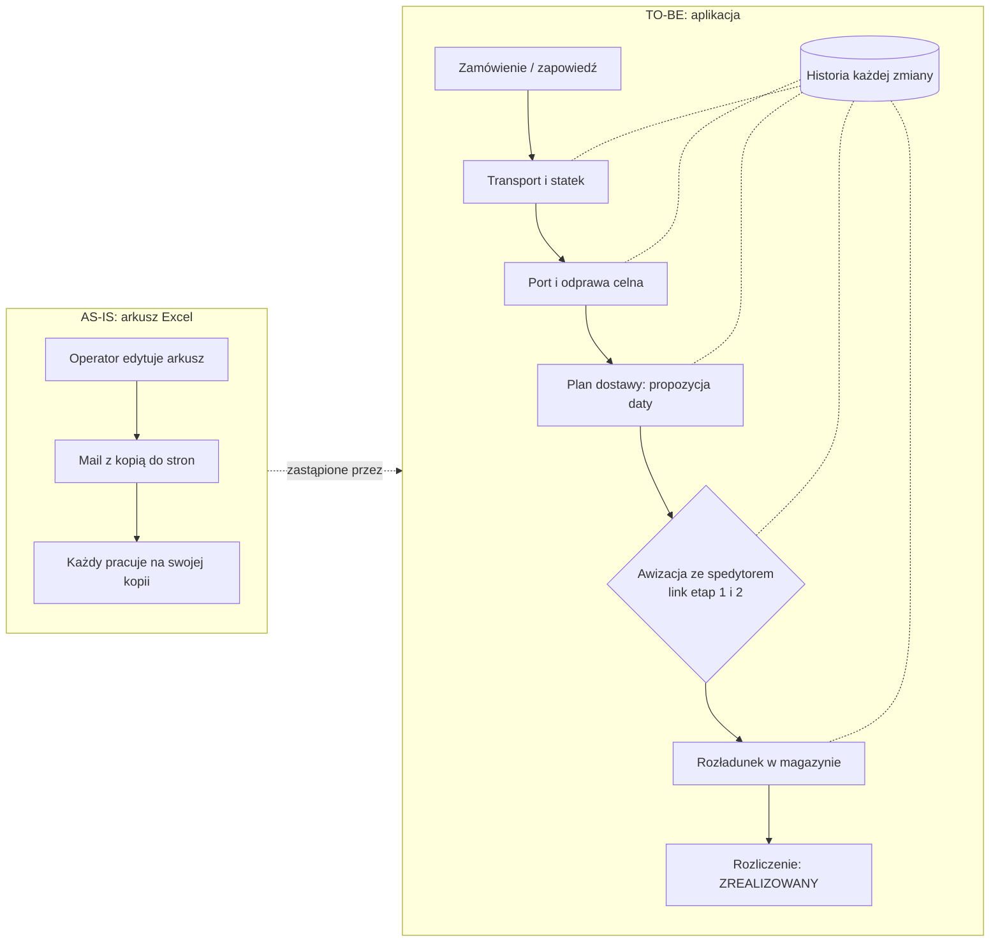

# Procesy AS-IS / TO-BE

Indeks [BA] (Z-012: bez przenoszenia istniejących dokumentów). Źródło obowiązujące: **`docs/02-proces.md`**
(aktorzy, proces przed i po wdrożeniu, cykl życia kontenera, tory równoległe, punkty decyzyjne — diagramy
Mermaid). Przy rozbieżności z niżej wymienionymi starszymi opisami obowiązuje `02-proces.md`, a dalej kod.

| Dokument | Co zawiera | Stan |
|---|---|---|
| [`../02-proces.md`](../02-proces.md) | AS-IS (arkusz, mail), TO-BE (aplikacja), 10 statusów, odprawa, awizacja dwuetapowa, decyzje | aktualny (odtworzony z kodu) |
| [`../03-user-flow.md`](../03-user-flow.md) | 18 ekranów rdzenia, przejścia, ścieżki alternatywne | aktualny |
| [`../bpmn/timporye-proces.bpmn`](../bpmn/timporye-proces.bpmn) | proces w BPMN 2.0 (do otwarcia w bpmn.io / Camunda Modeler) | starszy niż kod |
| [`../diagrams/`](../../diagrams/) | szczegółowy proces kontenera (Mermaid `.mmd`, Excalidraw, PNG/SVG) | starszy niż kod |
| [`../mapa-procesu-timporye.md`](../mapa-procesu-timporye.md), [`../mapa-procesow-szczegolowa.md`](../mapa-procesow-szczegolowa.md), [`../workflow-aplikacji-2026-09-16.md`](../workflow-aplikacji-2026-09-16.md) | mapy procesów per rola | **częściowo nieaktualne** — lista rozjazdów w [`../07-ograniczenia.md`](../07-ograniczenia.md#dokumentacja-niezgodna-z-kodem) |
| [`../REGULY-PROCESU.md`](../REGULY-PROCESU.md) | reguły biznesowe z datą decyzji | aktualny, utrzymywany |

## Rdzeń w jednym obrazie

Statusy kontenera (10) i odprawy (9), reguły cofania, automat „status z odprawy” — `02-proces.md`
§„Cykl życia kontenera”. Aktorzy i ich uprawnienia — `INTERESARIUSZE.md` oraz macierz `tests/permissions.yaml`.

## Zmiany procesu wymagają

1. wpisu w `REGULY-PROCESU.md` z datą decyzji PO (1 PR = 1 reguła),
2. aktualizacji `02-proces.md` (albo tego indeksu, gdy zmienia się mapa dokumentów),
3. testu reguły (`../testy/STRATEGIA_TESTOW.md`).
