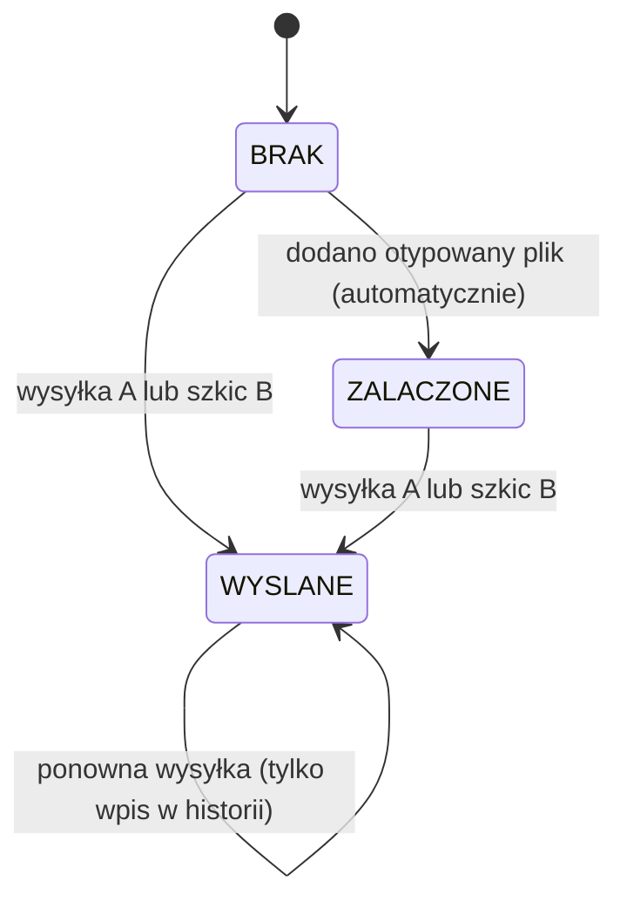
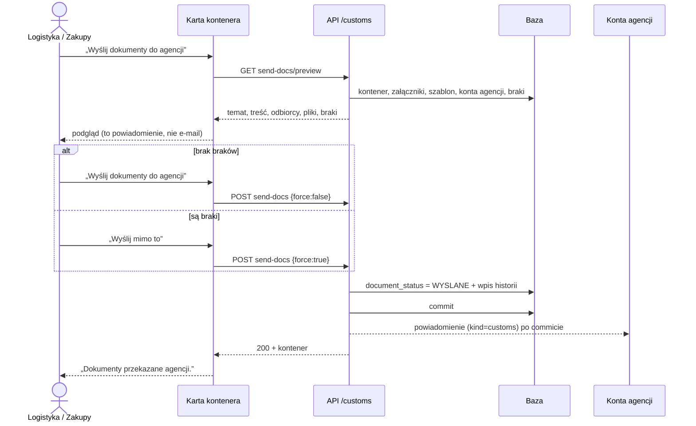
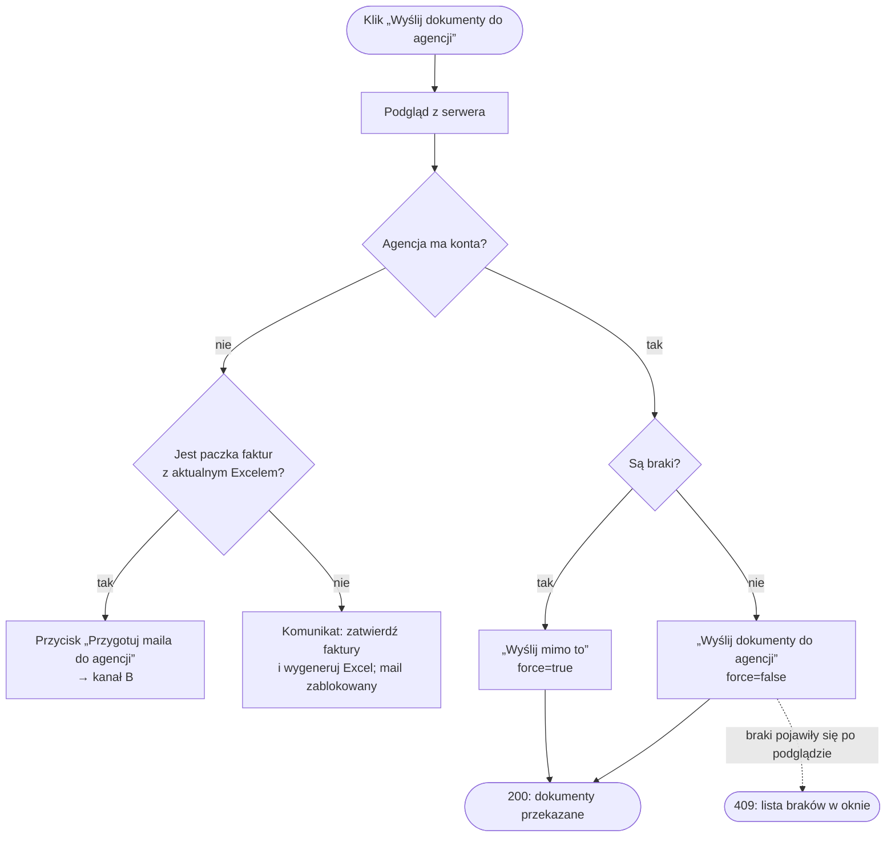

# Specyfikacja funkcji: wysyłka dokumentów do agencji celnej

| | |
|---|---|
| Wersja | 0.1 (2026-10-16), stan **as-is** (opis zachowania wdrożonego kodu) |
| Autorzy | [BA] treść i kryteria · [DEV] weryfikacja z kodem i testami · [SEC] §9 |
| Wymagania | FR-009 (W-09), FR-010 (W-10), FR-011 (W-11), FR-022…FR-024; decyzja **D4** (ostrzegaj, nie blokuj) |
| Status | do przeglądu PO; pytania w §11 |
| Źródła w kodzie | `backend/app/routers/customs.py` (`send_docs_to_agency`, `missing_document_types`), `backend/app/routers/doc_templates.py`, `backend/app/routers/invoice_agency.py`, `frontend/src/DocumentsW5.tsx` (`SendDocsPreviewModal`), `frontend/src/collaboration.tsx` (`sendDocs`), `frontend/src/AgencyMailPreviewModal.tsx` |
| Powiązane | `docs/MODUL_SPEDYCJA_AGENCJA_CELNA.md`, `docs/superpowers/specs/2026-09-01-kompletnosc-dokumentow-celnych-design.md`, `docs/superpowers/specs/2026-10-06-dokumenty-dostaw-design.md` |

Dokument opisuje **to, co aplikacja robi dziś**. Nie dodaje wymagań. Rozbieżności i luki
znalezione przy opisie są w §10, a decyzje dla PO w §11.

## 1. Cel biznesowy

Agencja celna dostaje komplet dokumentów do odprawy kontenera w jednym miejscu i w jednym
momencie. Nadawca widzi przed wysyłką, czego brakuje, i świadomie decyduje, czy wysłać mimo braków
(D4). Każda wysyłka zostawia ślad w historii kontenera: kto, kiedy, co i czy z brakami.

## 2. Dwa kanały wysyłki

Aplikacja ma dwie niezależne drogi. Obie ustawiają obieg dokumentów kontenera na `WYSLANE`.

| | **A. Powiadomienie w aplikacji** | **B. Szkic maila (.eml)** |
|---|---|---|
| Gdzie w UI | karta kontenera → „Pliki” → „Wyślij dokumenty do agencji” | karta kontenera → sekcja faktur → „Przygotuj maila do agencji” |
| Endpoint | `POST /api/customs/containers/{id}/send-docs` | `GET /api/invoice-batches/{batch_id}/agency-mail.eml` |
| Podgląd | `GET /api/customs/containers/{id}/send-docs/preview` | `GET /api/invoice-batches/{batch_id}/agency-mail/preview` |
| Odbiorca | aktywne konta roli `customs` przypisane do agencji kontenera | adresy z pola e-mail agencji (Do) i `avizo_cc` spółki (DW) |
| Co dostaje agencja | powiadomienie z listą nazw plików; pliki pobiera z karty kontenera | mail z plikami w załącznikach |
| Kto faktycznie wysyła | serwer (powiadomienie po zatwierdzeniu transakcji) | **użytkownik** z własnej skrzynki; serwer nic nie wysyła (decyzja 2026-09-24) |
| Sprawdza checklistę braków | tak (409 bez `force`) | nie; pokazuje ostrzeżenia o fakturach i kartotece |
| Treść | szablon per agencja albo domyślny (`doc_templates`) | stała treść z listą załączników |

Kanał B jest też drogą zastępczą, gdy agencja nie ma kont w aplikacji (§5.3).

## 3. Aktorzy i uprawnienia

| Rola | Kanał A (wysyłka, podgląd) | Kanał B (podgląd, .eml) | Odbiór |
|---|---|---|---|
| Administrator (`admin`) | tak | tak | — |
| Logistyka (`logistics`) | tak | tak | — |
| Zakupy (`purchasing`) | tak | tak | — |
| Agencja celna (`customs`) | **403** | **403** | dostaje powiadomienie; widzi i pobiera pliki kontenerów zleconych jej agencji |
| Spedytor (`forwarder`), magazyn (`warehouse`) | 403 | 403 | nie dotyczy; nie widzą kafelków SAD, PI, CI (spedytor także PL) |

Zasady wspólne:
- Uprawnienie roli: `PurchasingReaders` w `deps.py` (alias `docs_senders`).
- Dostęp do kontenera: `get_container_checked` → `check_container_access`. Kontener innej spółki
  daje **404** (nie ujawniamy, że istnieje).
- Agencję przypisuje tylko logistyka lub admin (`POST /api/customs/containers/{id}/assign`).
  Przypisanie ustawia status odprawy `ZLECONA` i powiadamia agencję. Zmiana agencji czyści dane
  agenta i powiadamia poprzednią agencję.

## 4. Warunki wstępne i dane

**Kontener w obiegu celnym** (`in_customs_flow`): ma przypisaną agencję albo status odprawy inny
niż `BRAK`. Tylko wtedy liczona jest checklista braków.

**Checklista braków** (`missing_document_types`): nazwy typów dokumentów, które są aktywne
i oznaczone `is_required`, a kontener nie ma żadnego załącznika tego typu. Słownik typów
prowadzi administrator. Plik bez typu nie zamyka braku.

**Obieg dokumentów kontenera** (`DocumentStatus`):

**Szablon treści kanału A** (`DocSendTemplate`): najpierw szablon agencji, potem domyślny
(bez agencji), a gdy nie ma żadnego, treść wbudowana:
- temat: `Dokumenty do odprawy: {container_no}`,
- treść: `Przekazano {liczba} plik(ów): {lista_dokumentow}. Pobierzesz je w zakładce plików kontenera.`

Pola szablonu: `{container_no}`, `{eta}`, `{lista_dokumentow}`, `{liczba}`. Nieznane pole
zostaje w tekście bez zmian, bez błędu. Szablony tworzy i zmienia tylko administrator.

## 5. Kanał A — powiadomienie w aplikacji

### 5.1 Przebieg główny

### 5.2 Reguły serwera (kolejność sprawdzeń)

| # | Warunek | Wynik |
|---|---|---|
| 1 | rola spoza admin, logistyka, zakupy | 403 |
| 2 | kontener niewidoczny dla użytkownika | 404 |
| 3 | brak przypisanej agencji | 409 „Kontener nie ma przypisanej agencji celnej.” |
| 4 | kontener nie ma żadnego załącznika | 409 „Brak załączników do wysłania — najpierw dodaj dokumenty.” |
| 5 | agencja nie ma aktywnych kont `customs` | 409 „Agencja nie ma kont w aplikacji…” ze wskazaniem kanału B |
| 6 | checklista ma braki i `force` nie jest `true` | 409 „Braki w checkliście dokumentów: …” z listą |
| 7 | wszystko spełnione | 200; obieg `WYSLANE`; wpis historii; powiadomienie |

Odmowa w krokach 3–6 nie zmienia danych ani obiegu dokumentów.

Wpis historii (pole `document_status`):
- notatka „wysyłka dokumentów do agencji celnej”,
- przy wysyłce z brakami dopisek „MIMO braków: <lista>” (D4, FR-009),
- przy ponownej wysyłce status się nie zmienia, ale wpis powstaje (stary = nowy = `WYSLANE`).

Powiadomienie: `notify(kind="customs")` do kont agencji, z pominięciem nadawcy. Według macierzy
reguł powiadomień może też wyjść e-mail (sam tekst, **bez plików**) oraz wiadomość na kanał Teams
i n8n. Wysyłka zewnętrzna dzieje się dopiero po zatwierdzeniu transakcji; wycofanie transakcji
oznacza brak wysyłki.

### 5.3 Przebiegi alternatywne (interfejs)

- Przycisk jest widoczny tylko dla admina, logistyki i zakupów, gdy kontener ma agencję i co
  najmniej jeden plik.
- „Wyślij mimo to” wysyła `force=true` tylko na podstawie braków pokazanych w **tym** podglądzie.
- Każda odmowa serwera zostaje w oknie jako komunikat. Sukces pokazuje się tylko po odpowiedzi 2xx.

## 6. Kanał B — szkic maila (.eml)

Mail składa serwer, a wysyła go użytkownik w Outlooku. Podgląd pokazuje dokładnie te części,
z których powstaje plik `.eml`.

**Odmowy (409):** brak agencji · agencja bez adresu e-mail · Excel paczki nieaktualny albo
niewygenerowany · brak pliku na dysku.

**Załączniki:**

| Kolejność | Plik | Warunek |
|---|---|---|
| 1 | `Faktury_<kontener>_<data>.xlsx` | zawsze |
| 2 | `kartoteka_symboli_<kontener>.xlsx` | zawsze (wzór z Master data) |
| 3 | `SAD_<kontener>.xml` (SADUE/WinSAD) | gdy da się zbudować; inaczej ostrzeżenie „Bez XML do WinSAD: …” |
| dalej | PDF zatwierdzonych faktur | status `confirmed` |
| dalej | packing listy z paczki | rozpoznane jako PL |
| dalej | B/L z paczki | rozpoznany jako konosament |
| dalej | pliki kontenera z kafelków CI i PL | także powiązane z kontenerem |
| dalej | najnowszy B/L z kafelka | tylko gdy paczka nie ma B/L |

**Ostrzeżenia w podglądzie** (nie blokują): niezatwierdzone faktury (nie trafią do maila),
pozycje bez dopasowania do Master data, pusta kartoteka symboli, puste wymagane kolumny
kartoteki, brak XML SADUE.

**Eksport częściowy:** temat dostaje dopisek „(częściowe n/m)”, a treść „pozostałe dośle(my) osobno”.

**Ślad:** pobranie `.eml` zapisuje w historii adresy Do i DW oraz listę plików z identyfikatorami
(nazwy po podmianie bywają takie same). Obieg dokumentów przechodzi na `WYSLANE`. Sam podgląd
nie zostawia śladu.

## 7. Komunikaty dla użytkownika

| Sytuacja | Tekst (PL) | Źródło |
|---|---|---|
| podgląd kanału A | „Agencja dostanie powiadomienie w aplikacji z listą plików (to nie jest e-mail)…” | `i18n/features/wyslij-do-agencji.ts` |
| agencja bez kont | „agencja nie ma kont w aplikacji — powiadomienie do nikogo nie dotrze; wyślij mailem…” | j.w. |
| brak Excela | „Brak paczki faktur z aktualnym Excelem — zatwierdź faktury i wygeneruj Excel…” | j.w. |
| sukces | „Dokumenty przekazane agencji.” | `i18n/pl.base.ts` |
| braki | przycisk „Wyślij mimo to” | `i18n/pl.base.ts` |

Teksty istnieją w PL, EN i PT.

## 8. Kryteria akceptacji (Dane / Gdy / Wtedy) i testy

| ID | Dane | Gdy | Wtedy | Test |
|---|---|---|---|---|
| AK-01 | kontener z agencją | użytkownik agencji wywołuje wysyłkę | 403 | `test_customs.py::test_send_docs_to_agency` |
| AK-02 | kontener z agencją, bez plików | logistyka wysyła | 409, obieg bez zmian | j.w. |
| AK-03 | agencja ma konto, jest plik, brak braków | logistyka wysyła | 200, `WYSLANE`, powiadomienie „Dokumenty do odprawy…” | j.w. |
| AK-04 | jak AK-03 | agencja otwiera pliki kontenera | widzi wysłany plik | j.w. |
| AK-05 | checklista ma braki | wysyłka bez `force` | 409 z nazwami brakujących typów | `test_customs.py::test_document_checklist_flow` |
| AK-06 | jak AK-05 | wysyłka z `force=true` | 200, `WYSLANE`, w historii „MIMO braków” | j.w. |
| AK-07 | plik bez typu | lista braków | brak nadal widoczny, obieg `BRAK` | j.w. |
| AK-08 | plik z wymaganym typem | lista braków | brak znika, obieg `ZALACZONE` | j.w. |
| AK-09 | agencja bez kont | podgląd, potem wysyłka z `force` | podgląd: pusta lista odbiorców; wysyłka 409 „nie ma kont”; obieg nie `WYSLANE` | `test_customs.py::test_send_docs_is_honest_about_recipients` |
| AK-10 | szablon z polami i nieznanym polem | podgląd i wysyłka | pola podstawione, nieznane zostaje; powiadomienie z tematu szablonu | `test_w5_documents.py::test_doc_template_render_preview_and_send` |
| AK-11 | podgląd z brakami | klik „Wyślij mimo to” | żądanie z `force=true` | `sendDocsPreview.dom.test.tsx` |
| AK-12 | agencja bez kont, jest paczka z aktualnym Excelem | podgląd | zamiast wysyłki przycisk maila | j.w. |
| AK-13 | agencja bez kont, brak aktualnego Excela | podgląd | wskazówka, mail zablokowany | j.w. |
| AK-14 | kanał B: brak agencji / e-maila / aktualnego Excela / pliku | pobranie `.eml` | 409 z powodem | `test_invoice_agency_mail.py::test_eml_refusals`, `::test_eml_unconfirmed_batch_blocked` |
| AK-15 | kanał B: zakupy innej spółki; agencja | pobranie `.eml` | 404; 403 | `test_invoice_agency_mail.py::test_eml_isolation_and_roles` |
| AK-16 | kanał B | podgląd i `.eml` | te same pliki i treść | `test_invoice_agency_mail.py::test_preview_shows_exactly_what_eml_contains` |
| AK-17 | kanał B, B/L podmieniony | `.eml` | tylko najnowszy B/L; obieg `WYSLANE` | `test_invoice_agency_mail.py::test_mail_takes_newest_bl_loose_ci_and_marks_sent` |
| AK-18 | kanał B, część faktur | `.eml` | temat „(częściowe n/m)” | `test_invoice_agency_mail.py::test_partial_export_is_marked_in_subject_and_body` |
| AK-19 | obieg już `WYSLANE` | ponowna wysyłka A | 200, status bez zmian, nowy wpis historii | **brak testu** |
| AK-20 | kontener innej spółki | wysyłka A | 404 | **brak testu dedykowanego** (ochrona przez `check_container_access`, testy IDOR ogólne) |

## 9. Bezpieczeństwo [SEC]

Klasa danych: dokumenty handlowe i celne (faktury, PL, B/L, SAD) to **F — poufne handlowe**
(`docs/bezpieczenstwo/KLASYFIKACJA_DANYCH.md`). Nazwy plików i numer kontenera trafiają do treści
powiadomień.

| STRIDE | Zagrożenie | Kontrola dziś | Ocena |
|---|---|---|---|
| S | wysyłka w cudzym imieniu | sesja JWT, CSRF (Origin) | OK |
| T | podmiana pliku po podglądzie | kanał B: identyfikatory plików w historii; kanał A: lista nazw w historii nie jest zapisywana | luka L-3 |
| R | „nie wysyłałem z brakami” | historia: użytkownik, czas, „MIMO braków” | OK |
| I | wyciek do innej spółki lub agencji | `check_container_access` (404), agencja widzi tylko zlecone; odbiorcy liczeni z agencji kontenera | OK; brak testu AK-20 |
| I | treść powiadomienia (numer, nazwy plików) na kanale Teams / n8n | `notify` wysyła na kanał wspólny | luka L-4 — do oceny |
| D | duży mail .eml (pliki w pamięci) | limity uploadu przy wgrywaniu | akceptowalne |
| E | agencja zatwierdza wysyłkę sama sobie | rola `customs` → 403 | OK |

## 10. Luki i rozbieżności znalezione przy opisie

| ID | Opis | Skutek | Propozycja |
|---|---|---|---|
| L-1 | Kanał A sprawdza, czy agencja ma konta, ale `notify` pomija konta z trybem „tylko obserwowane”, które nie obserwują kontenera, i nadawcę. Wynik 0 dostarczonych powiadomień nie jest sprawdzany. | obieg `WYSLANE`, choć nikt nie dostał powiadomienia | traktować liczbę odbiorców 0 jak brak kont (409) albo pomijać filtr obserwowanych dla tego rodzaju |
| L-2 | Pobranie `.eml` ustawia `WYSLANE`, choć mail wysyła dopiero użytkownik i może tego nie zrobić. | fałszywy stan obiegu | ręczne potwierdzenie „wysłałem” albo osobny stan „przygotowano” |
| L-3 | Kanał A nie zapisuje w historii, które pliki poszły (kanał B zapisuje). | słabszy ślad przy sporze | dopisać listę plików z identyfikatorami do notatki |
| L-4 | Treść powiadomienia może trafić na wspólny kanał Teams / n8n. | numer kontenera i nazwy plików poza aplikacją | decyzja SEC + PO; ewentualnie `broadcast=False` |
| L-5 | Checklista kanału A korzysta z typów `is_required` (globalnie), a ostrzeżenia przy zmianie statusu z kafelków według etapu (`document_tiles`). | dwa różne obrazy „braków” | ujednolicić źródło braków (FR-011) |
| L-6 | Kanał A liczy pliki należące do kontenera, a kanał B także pliki powiązane (`in_container`). | plik powiązany nie trafia do listy w powiadomieniu | jedno zapytanie dla obu kanałów |
| L-7 | Podgląd mówi „to nie jest e-mail”, a według macierzy reguł może wyjść e-mail z samym tekstem. | mylący komunikat | doprecyzować tekst |
| L-8 | Brak testów AK-19 i AK-20. | regresje niewykrywane | dopisać testy (bez zmiany zachowania) |

Żadna luka nie jest naprawiana w tym dokumencie. Każda wymaga decyzji PO: historyjka albo akceptacja.

## 11. Pytania do PO

1. **L-1 i L-2:** czy `WYSLANE` ma znaczyć „agencja na pewno dostała”, czy „wysyłka została zlecona”?
2. **L-4:** czy treść powiadomień o dokumentach może trafiać na kanał Teams / n8n?
3. **L-5:** które źródło braków jest właściwe: słownik typów czy kafelki według etapu?
4. Czy kanał A (powiadomienie) ma zostać, skoro agencje bez kont i tak dostają mail (kanał B)?
5. Czy wysyłka z brakami ma wymagać podania powodu (dziś tylko klik „Wyślij mimo to”)?

Do czasu odpowiedzi BA przyjmuje stan obecny jako obowiązujący (zapis w `ZALOZENIA.md`, Z-019).
