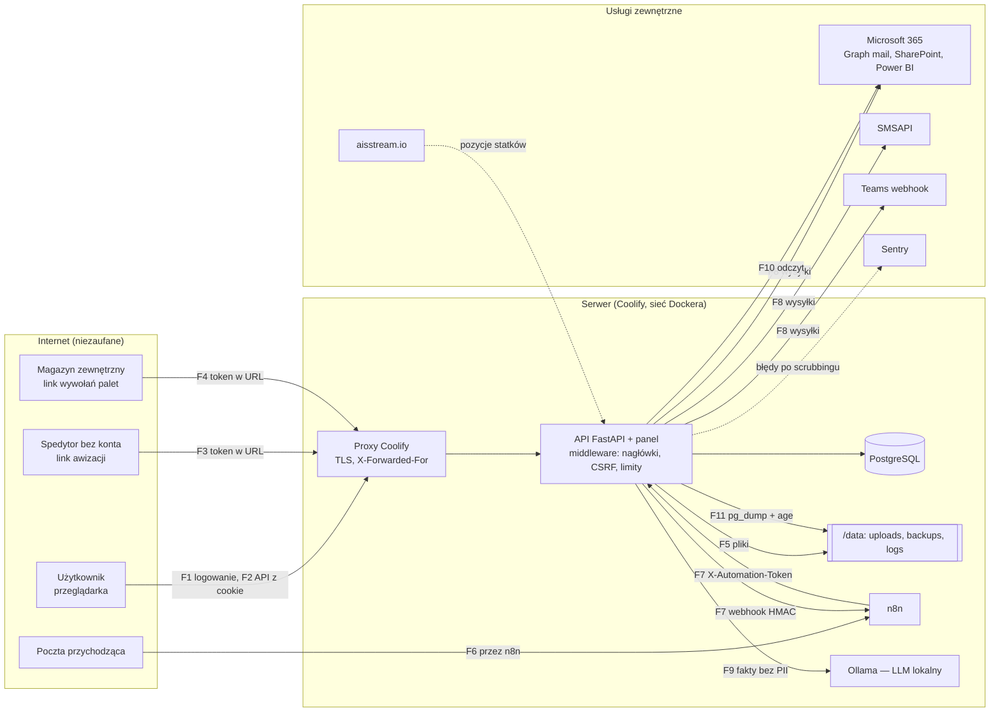

# Model zagrożeń (STRIDE) — wersja 0.1

2026-10-16, [SEC]. Zakres: przepływy danych aplikacji na produkcji (Coolify, jeden kontener API + panel,
PostgreSQL) i instancji demo. Każdy przepływ: zagrożenia STRIDE, kontrola istniejąca (zweryfikowana w kodzie,
`docs/AUDYT.md` §3.1) i luka z odwołaniem do rejestru ryzyk (`RYZYKA.md`) lub historyjki.
Nowa funkcja = nowy wiersz albo nowy przepływ **przed** kodem (krok 2 procesu).

Kategorie: **S** podszywanie · **T** manipulacja · **R** wyparcie się · **I** ujawnienie · **D** odmowa
usługi · **E** eskalacja uprawnień.

## Diagram przepływów i granic zaufania

Granice zaufania: Internet → proxy (TLS), proxy → API (tylko sieć Dockera ufa `X-Forwarded-For`), API → usługi
zewnętrzne (sekrety w env), API → Ollama (bez uwierzytelniania, dlatego tylko adres wewnętrzny).

## Aktywa

| Aktywo | Klasa (`KLASYFIKACJA_DANYCH.md`) | Dlaczego cenne |
|---|---|---|
| Dane kontenerów kilku spółek i partnerów | W/F | konkurencyjne spedycje i spółki nie mogą widzieć się nawzajem |
| Dane osobowe kierowców i użytkowników | O | RODO; osoby trzecie bez konta |
| Dokumenty handlowe, faktury, SAD, ceny | F | wartość handlowa, tajemnica przedsiębiorstwa |
| Sekrety (JWT, Fernet, M365, SMSAPI, n8n, `age`) | S | przejęcie = przejęcie całej aplikacji i integracji |
| Integralność historii zmian | W | rozliczalność decyzji (kto cofnął status, kto przekroczył limit) |
| Dostępność w godzinach pracy logistyki | — | awaria = powrót do maila i arkusza |

## Przepływy

### F1 · Logowanie i sesja (panel ↔ `/api/auth/*`)

| STRIDE | Zagrożenie | Kontrola | Luka / ryzyko |
|---|---|---|---|
| S | zgadywanie haseł, credential stuffing | bcrypt 12, polityka haseł, limity IP+login / IP / konto (w bazie), lista zablokowanych IP, stały czas odpowiedzi | — |
| S | przejęcie konta admina | 2FA TOTP dostępne; wymuszenie dla adminów wyłączone | E-01 (US-019) |
| S | kradzież cookie sesji | `HttpOnly`, `Secure` za HTTPS, access 2 h, refresh rotowany, wykrycie ponownego użycia → unieważnienie rodziny | sesje po HTTP tylko z jawnym `ALLOW_INSECURE_HTTP` (E-06) |
| T | podrobienie JWT | HS256 z `SECRET_KEY` ≥ 32 znaki (fail-fast) | klucz wspólny z szyfrowaniem danych — R-05 |
| R | „to nie ja się logowałem” | log logowań z IP (90 dni) | — |
| I | enumeracja kont | stały czas odpowiedzi; reset hasła zawsze 202 | — |
| D | zalew logowań | limity + globalny limit API | limiter API w pamięci procesu (E-04) |
| E | podgląd „jako rola” nadużyty | token impersonacji tylko GET, 60 min, `sub` = admin w audycie | — |

### F2 · API z cookie sesji (zapisy, odczyty, eksporty)

| STRIDE | Zagrożenie | Kontrola | Luka / ryzyko |
|---|---|---|---|
| S | CSRF z obcej strony (ten sam „site” dla IP) | `X-Requested-With` albo `Origin`/`Referer` = adres aplikacji; 403 | żądania bez `Origin` i `Referer` przechodzą (klient nie-przeglądarkowy) — E-07 |
| T | podmiana `company_id` / id cudzego rekordu (IDOR) | `deps.py`: `scope_*`, `get_scoped`, `check_container_access`; 404; macierz rola × trasa | izolacja tylko w kodzie — **R-01**, US-011 |
| T | ciche nadpisanie przy równoczesnej edycji | — | **R-02**, US-003 |
| T | formuły w eksportach XLSX/CSV | `append_row`, `csv_safe` | `\t`, `\r` — US-008 |
| R | zmiana bez autora | `audit_log` każdej zmiany pola, n8n podpisane kontem serwisowym | — |
| I | wyciek pól innej roli (ceny, odprawa) | `hidden_fields`, `forwarder_may_see`, wyszukiwarka po ukrytych polach zablokowana | — |
| I | host-header injection w linkach e-mail | `PUBLIC_BASE_URL` wymagany na prod; `ALLOWED_HOSTS` opcjonalny | `ALLOWED_HOSTS` puste domyślnie — E-08 |
| D | zalew API | 300 żądań/min na IP (pamięć procesu) | E-04 |
| E | rola niższa woła trasę admina | `require_roles`, `test_permissions_matrix` | — |

### F3 · Publiczny link awizacji (spedytor i kierowca bez konta)

| STRIDE | Zagrożenie | Kontrola | Luka / ryzyko |
|---|---|---|---|
| S | zgadnięcie tokenu | ≥ 16 znaków losowych, SHA-256 w bazie, jednorazowy, 7/5 dni, maks. 90 | — |
| S | link przekazany dalej | tylko formularz jednej awizacji; dane kierowcy wpisuje odbiorca | akceptowane (D3) |
| T | odpowiedź z obcej strony | kontrola `Origin`; zatwierdzenie przez logistykę (FR-020) | — |
| I | token w logach, Referer, wyszukiwarkach | maskowanie `[token]`, `no-referrer`, `noindex` | — |
| I | dane kierowcy w SMS/mailach | treść bez danych osobowych poza niezbędnymi; retencja 90 dni | — |
| D | zalew formularza | 30 żądań/min na IP | parametr daty slotów bez zakresu (T-03) — US-005 |

### F4 · Publiczny link wywołań palet (MAG-1)

| STRIDE | Zagrożenie | Kontrola | Luka / ryzyko |
|---|---|---|---|
| S | zgadnięcie tokenu | jak F3 (`public_links.py`, limit 90 dni) | — |
| T/D | zalew, obce Origin | brak własnego limitu i kontroli pochodzenia | **R-06**, US-005 |
| R | „nie my potwierdziliśmy wysyłkę” | status zmieniany z tokenem jednej firmy | status „wysłane” przed faktycznym mailem (T-20) |

### F5 · Pliki: załączniki, importy Excel/SAP, ZIP, PDF, .msg/.eml, zdjęcia

| STRIDE | Zagrożenie | Kontrola | Luka / ryzyko |
|---|---|---|---|
| T | złośliwy plik pod dozwolonym rozszerzeniem | lista rozszerzeń; sygnatury bajtów tylko dla zdjęć/awatarów; nazwa na dysku z losowym składnikiem | **R-03**, US-004 |
| T | PDF z numerem innego kontenera | bramka `document_gate` (409) | — |
| I | plik spedytora widoczny dla agencji i odwrotnie | `forwarder_may_see`, kafelki ukryte dla magazynu | — |
| D | plik ogromny / zip bomb / XML bomb / 300-stronicowy skan | `MAX_UPLOAD_MB` na każdej trasie, limit plików w ZIP, limit stron PDF, OCR w tle, limity RAM kontenera | ZIP z deklarowanego rozmiaru, XML stdlib — **R-07**, US-006 |
| E | ścieżka w nazwie pliku (path traversal) | nazwa sanityzowana (`safe`), `stored_name` własny | — |

### F6 · Poczta przychodząca → poczekalnia dokumentów (przez n8n)

| STRIDE | Zagrożenie | Kontrola | Luka / ryzyko |
|---|---|---|---|
| S | obcy nadawca tworzy wpisy | token n8n → konto logistyki (rola) | brak listy zaufanych nadawców (T-04) — E-09 |
| T | załącznik złośliwy | jak F5 | R-03, R-07 |
| D | zalew mailami | limit API na IP n8n | — |

### F7 · Automatyzacje n8n: token wejściowy i webhook zdarzeń

| STRIDE | Zagrożenie | Kontrola | Luka / ryzyko |
|---|---|---|---|
| S | wyciek `AUTOMATION_API_TOKEN` | ≥ 32 znaki na prod, porównanie w stałym czasie, konto serwisowe bez roli admin, opcjonalne CIDR i termin ważności, rotacja z poprzednim tokenem | CIDR i termin opcjonalne — E-10 |
| T | podrobione zdarzenie do n8n | HMAC-SHA256 (`X-Timporye-Signature`), ostrzeżenie przy braku sekretu | — |
| R | zmiana z n8n bez śladu | audyt na konto serwisowe | odpowiedzi 4xx/5xx webhooka ignorowane (P-11) |
| E | n8n za tą samą bramą = ten sam origin | opisane; docelowo osobny host i `__Host-` | E-07 |

### F8 · Wysyłki: e-mail (Graph/SMTP), SMS, Teams

| STRIDE | Zagrożenie | Kontrola | Luka / ryzyko |
|---|---|---|---|
| T | wstrzyknięcie HTML do maila | Jinja2 autoescape, `html.escape` | — |
| I | dane kierowcy w kanałach zewnętrznych | treść bez danych kierowcy (reguła z 2026-09-28) | — |
| I | sekrety M365/SMSAPI | env; cache MSAL szyfrowany Fernet | klucz Fernet = `SECRET_KEY` bez `DATA_ENCRYPTION_KEY` — R-05 |
| D | koszty SMS (pumping) | `SMS_DAILY_CAP`, limit prób, alert 80 % | — |
| R | „mail nie wyszedł” | status wysyłki; brak ponawiania SMTP (P-12) | US-022 |

### F9 · Asystent wiedzy (lokalny LLM, Ollama)

| STRIDE | Zagrożenie | Kontrola | Luka / ryzyko |
|---|---|---|---|
| T | prompt injection z pytania użytkownika | model dostaje fakty z bazy (JSON) po izolacji roli + stały prompt systemowy; odpowiedź tylko wyświetlana (brak narzędzi, brak zapisu) | ryzyko niskie; monitorować przy rozszerzeniu o akcje |
| I | pola ukryte dla roli w prompcie | `hidden_fields` stosowane przed budową faktów | — |
| I | dane opuszczają serwer | `OLLAMA_URL` tylko adres wewnętrzny; zdalny wymaga `OLLAMA_ALLOW_REMOTE` | — |
| D | zajęcie CPU/RAM | 1 równoległe wywołanie, 10 pytań/min/użytkownik, timeout | — |

### F10 · Odczyt z Microsoft 365 (SharePoint, Power BI) i AIS

| STRIDE | Zagrożenie | Kontrola | Luka / ryzyko |
|---|---|---|---|
| T | arkusz SharePoint cofa dane aplikacji | synchronizacja ręczna; status tylko do przodu (FR-025) | — |
| I | sekrety aplikacji M365 | env, `Sites.Selected` (tylko odczyt wskazanej witryny) | — |
| D | nieoczekiwana odpowiedź = 500 | — | T-08…T-12 (US-026) |

### F11 · Kopie zapasowe i odtworzenie

| STRIDE | Zagrożenie | Kontrola | Luka / ryzyko |
|---|---|---|---|
| I | kradzież pliku kopii | szyfrowanie `age` (klucz publiczny na serwerze, prywatny poza) | — |
| D | utrata serwera = utrata kopii | kopie lokalne; cotygodniowa weryfikacja | **R-10**, US-013 |
| T | kopia nie do odtworzenia | `verify_backup.py` co tydzień | — |

### F12 · Administracja (konta, słowniki, konfiguracja)

| STRIDE | Zagrożenie | Kontrola | Luka / ryzyko |
|---|---|---|---|
| E | konto serwisowe z rolą admin | zablokowane (`check_service_account`) | — |
| R | usunięcie konta zaciera historię | usunięcie = anonimizacja, audyt zostaje | — |
| I | `/docs` z pełną powierzchnią API | wyłączone na produkcji | — |
| D | zła konfiguracja na produkcji | fail-fast: sekrety, `PUBLIC_BASE_URL`, `SECURE_COOKIES` | `DATABASE_URL`, `DATA_ENCRYPTION_KEY` — **R-04**, R-05 |

### F13 · CI/CD i łańcuch dostaw

| STRIDE | Zagrożenie | Kontrola | Luka / ryzyko |
|---|---|---|---|
| T | podmieniona zależność lub akcja | `pip --require-hashes`, akcje po SHA, obrazy bazowe po digest, lock npm | — |
| I | sekret w commicie | gitleaks na PR i co tydzień na całej historii; pre-commit | — |
| T | podatna zależność / obraz | pip-audit, npm audit (bramki przy zmianie), Trivy (raport), SBOM | Trivy nie bramkuje, brak Semgrep — **R-08**, US-007 |
| E | agent z prawem zapisu w CI | workflowy `claude*` nie istnieją w tym repo; `permissions: contents: read` | — |

## Otwarte decyzje

- R-01: czy spójność spółki wymuszać także w bazie (CHECK/FK/RLS) — ADR w US-011.
- E-01: 2FA adminów — decyzja PO (Z-008).
- Przepływ „instancja demo” nie ma osobnej tabeli: dane syntetyczne, konto tylko do odczytu, reset nocny (E-05).
