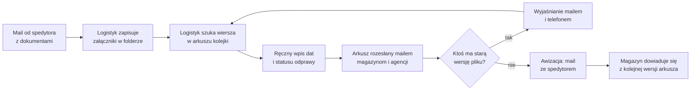

# Obieg dokumentu przed i po — z automatami

Wycinek procesu, w którym automaty robią najwięcej: od maila z dokumentami do potwierdzonej dostawy.
Cały proces przed i po wdrożeniu (aktorzy, tory, punkty decyzyjne): [`../02-proces.md`](../02-proces.md);
model BPMN 2.0 (5 torów): [`../bpmn/timporye-proces.bpmn`](../bpmn/timporye-proces.bpmn); fakty o stanie
„przed” — [`../01-problem-i-zakres.md`](../01-problem-i-zakres.md).

## Przed: arkusz Excel na SharePoincie + mail

**Gdzie ginie czas** (4 osoby, ok. 30 h tygodniowo łącznie):
- przepisywanie tych samych danych z maila do arkusza i z arkusza do maila,
- uzgadnianie wersji pliku („która wersja jest aktualna?”),
- brak statusu i historii: każdy wylicza etap kontenera z dat po swojemu, nie wiadomo, kto zmienił datę,
- brak walidacji: błędny numer kontenera wychodzi dopiero u spedytora.

## Po: aplikacja + automaty

```mermaid
flowchart LR
  A[Mail od spedytora<br/>z dokumentami] --> B[n8n przekazuje mail<br/>do aplikacji]
  B --> C[Automat: numer kontenera<br/>z treści, cyfra kontrolna]
  C --> D[Poczekalnia dokumentów<br/>kontenera]
  D --> E[Logistyk: „Potwierdź”]
  E --> F[Odczyt faktury<br/>reguły + model ML]
  F --> G{Pewność ≥ progu?}
  G -- tak --> H[Dopasowanie ustawione<br/>automatycznie]
  G -- nie --> I[Podpowiedź<br/>do decyzji człowieka]
  H --> J[Jeden stan kontenera<br/>dla wszystkich stron]
  I --> J
  J --> K[Awizacja przez<br/>jednorazowy link spedytora]
  K --> L[Magazyn widzi dostawę<br/>i potwierdza rozładunek]
  J -. alerty: kara za przestój,<br/>braki dokumentów, opóźnienia .-> M[Powiadomienia<br/>e-mail · Teams · SMS]
```

## Co się zmieniło

| Krok | Przed | Po |
|---|---|---|
| Dokumenty z maila | ręczne zapisanie w folderze | automat przypisuje do kontenera, człowiek potwierdza |
| Stan kontenera | wyliczany z dat po swojemu | 10 statusów, jeden dla wszystkich stron |
| Historia | brak | każda zmiana pola: kto, kiedy, było → jest, powód |
| Numer kontenera | dowolny tekst | walidacja ISO 6346 przy wpisie |
| Faktury | przepisywanie pozycji | odczyt OCR + reguły + model ML z progiem pewności |
| Awizacja | korespondencja mailowa | jednorazowy link dla spedytora, bez zakładania konta |
| Partnerzy | kopie arkusza | własny widok: każdy widzi tylko swoje kontenery |
| Pilnowanie terminów | pamięć logistyka | 22 automaty z harmonogramu + 3 obiegi z n8n |
